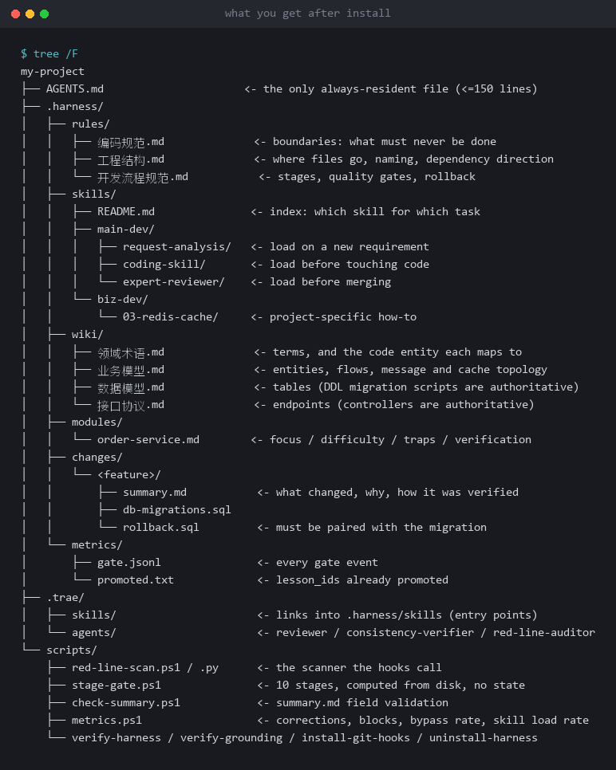
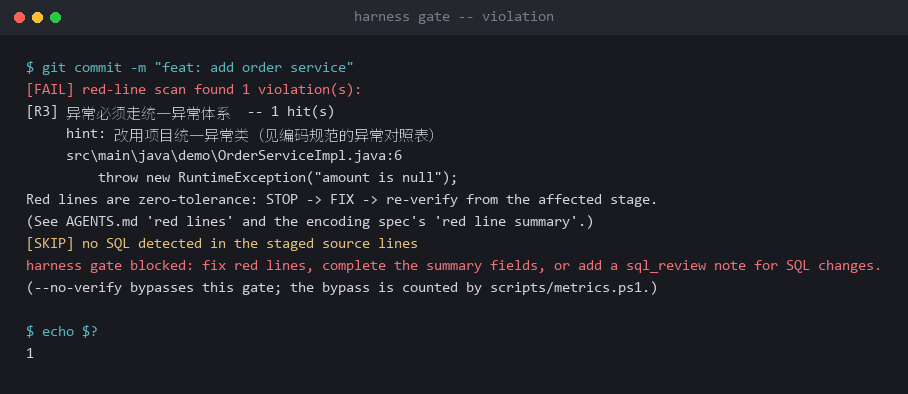
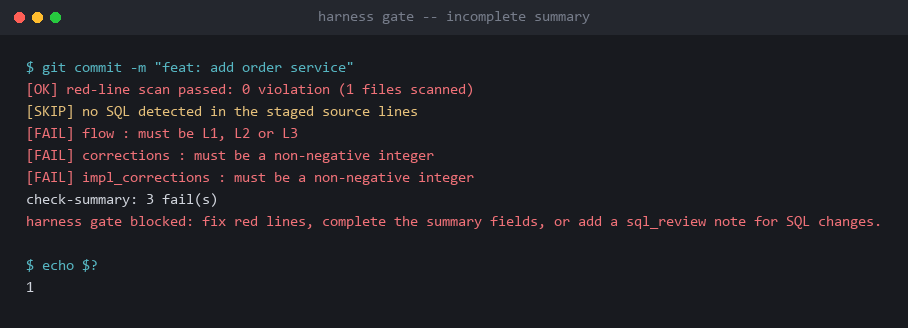
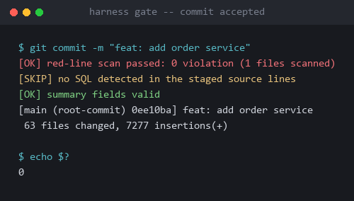

# Harness Bootstrap

Installs an executable constraint system into an AI coding project: rules, gates, evidence, metrics and review.

It is not a prompt collection and not a template pack. It probes the project, then generates `AGENTS.md`, rules, skills and wiki pages from evidence. After installation, the project's conventions are enforced by scripts and git hooks rather than by reminders.

[](https://github.com/fengyale/harness-bootstrap/actions/workflows/verify.yml)
[](https://github.com/fengyale/harness-bootstrap/releases)
[](LICENSE)
[](references/平台适配.md)

---

## What it solves

AI can write code, but shipping it safely is a different question: unwritten project rules get missed, "done" is reported before the build passes, and the same mistake returns next task.

This package turns those judgements into executable gates and reviewable records:

| Before | After |
| --- | --- |
| Project knowledge is re-supplied by hand every round | Written into `AGENTS.md`, rules and wiki, loaded on demand, indexed |
| Rules exist but the agent never reads them | Exit checks: `summary.md` fields, stage gates, `verify-*` scripts |
| Gates rely on discipline; `--no-verify` skips them | git hooks block; bypasses are recorded and counted in `bypassRate` |
| No way to tell whether things improve | `metrics.ps1` trends corrections, blocks and skill load rate |
| The same mistake repeats | On the 2nd `lesson_id`, the script prompts promotion to a rule, gate or skill |

## Quick start

Inspect it before installing anything:

```powershell
git clone https://github.com/fengyale/harness-bootstrap.git
cd harness-bootstrap
powershell -NoProfile -ExecutionPolicy Bypass -File tools\verify-package.ps1
```

Output:

```text
[PASS] parse      23 .ps1 file(s) parse
[PASS] encoding   ASCII without BOM, or UTF-8 with BOM
[PASS] json       4 JSON file(s) parse
[PASS] version    VERSION and releases.json both say <version>
[PASS] structure  required files present, package-only files absent
[PASS] contract   60 rule/script/doc contract(s) hold
[PASS] docs       README counts, reference numbers and page version match the files
[PASS] smoke      install -> stage 4 -> unfilled summary rejected -> SQL missing/hollow/no-op probes -> uninstall, in a temp copy

package gate: OPEN
```

The 60 contracts check one thing: the same rule is worded identically in scripts, JSON, `SKILL.md`, `AGENTS.md` and rule files. Changing one copy and leaving the others behind is the most common failure in this category.

Run the behavioural tests:

```powershell
powershell -NoProfile -ExecutionPolicy Bypass -File tests\run-all.ps1
```

Four suites build throw-away projects under `%TEMP%` and assert real exit codes: missing row BLOCKED, placeholder SKIP, compile/test actually executed, pre-commit checking base fields only, three hooks installed and removed, A3+ spoof rejected, upgrade replacing machinery while keeping history, and the commit-range summary-order audit.

## Install

### 1. Put it in the skill directory

| Platform | Location |
| --- | --- |
| TRAE | `.trae/skills/harness-bootstrap/` |
| Claude Code | `.claude/skills/harness-bootstrap/` |
| Codex CLI | `.codex/skills/harness-bootstrap/` (no sub-agents; do not copy the agents directory) |
| CodeBuddy | `.codebuddy/skills/harness-bootstrap/` (no sub-agents; do not copy the agents directory) |
| Other / unknown | Reference `SKILL.md` in index mode |

`tools/` is for this package only and is never copied into a project.

### 2. Run `SKILL.md` step 0

The agent probes the platform and the project, then takes one of two paths:

- Existing project: run `probe-project.ps1` and `probe-stack.ps1`, then generate `AGENTS.md`, rules, skills, wiki pages and module cards from evidence.
- New project: confirm background, business and stack first, write `.harness/project-brief.md`, then generate the skeleton.

Both paths follow the grounding protocol: project claims need E1 (a runnable command) or E2 (a real file and line number). Only a new project without code may use E0 (user confirmation), and it must be upgraded once code lands.

### 3. Install the gates

```powershell
powershell -NoProfile -ExecutionPolicy Bypass -File scripts\install-git-hooks.ps1
```

Three hooks:

- `pre-commit`: red-line scan (new lines only), SQL review, summary base fields;
- `post-commit`: records whether the commit was covered by the gate, used for the bypass rate;
- `pre-merge-commit`: merge commits go through the same gate.

### 4. Verify

```powershell
powershell -NoProfile -ExecutionPolicy Bypass -File scripts\verify-harness.ps1
powershell -NoProfile -ExecutionPolicy Bypass -File scripts\verify-grounding.ps1
powershell -NoProfile -ExecutionPolicy Bypass -File scripts\stage-gate.ps1 -Stage 7 -Feature <name>
```

`verify-*` passing means the structure is correct. A1–A4 and A6 require running a real task; A7 needs two consecutive 14-day windows. The repository does not claim those for you.

### 5. Upgrade an existing install

Do not re-run step 0: it is Copy-Missing and will not replace old scripts. Use the upgrade entry:

```powershell
# plan only, no files changed
powershell -NoProfile -ExecutionPolicy Bypass -File scripts\update-harness.ps1 `
  -PackagePath <new package root> -MergeSkills
# apply
powershell -NoProfile -ExecutionPolicy Bypass -File scripts\update-harness.ps1 `
  -PackagePath <new package root> -Apply -MergeSkills
```

`-MergeSkills` lets installed skills pick up new package text: the new template becomes the skeleton and only the `harness:project` blocks are swapped back to the project's own. Without it, installed skills are reported as `MANUAL` while the machinery scripts still upgrade.

`scripts\*.ps1` / `*.py` is replaced (old files are backed up under `.harness\upgrade\`); `scripts\*.json`, project assets and `.harness\changes|metrics` are kept. `AGENTS.md` and `harness-required.json` only merge known framework lines/keys (`-NoMergeKnown` prints the difference instead); the red-line summary only replaces the R5/R6 checked cell. Old L1 summary directories move to the upgrade backup and are deleted after verification (`-KeepL1` keeps them); L2/L3 history is never touched. Installed skill bodies only report a difference by default; `-MergeSkills` uses the new template as the skeleton and swaps back only the `harness:project` blocks compiled on disk (frontmatter kept, project-only blocks appended; an unmatched block or a remaining slot is PENDING, more than 120 lines is MANUAL, and neither writes the file); `-UpdateSkills` replaces only uncompiled copies that still contain `slot:` markers; `-ForceSkills` overrides, but it resets skills to slot-bearing skeletons: recompile them and run `verify-harness.ps1` again, and use `-SkipVerify` for the reset step. The skill index and `_template` are treated as project-owned and package-owned respectively. After upgrading, run stages 3/5/7/10 and fill the measured commands in `AGENTS.md`.

## What you get



```text
AGENTS.md                    the only resident file (<=150 lines): stack, commands, red lines, index, discipline
.harness/
  rules/                     coding conventions, structure, development flow
  skills/                    skill bodies, loaded on demand through platform entries
  wiki/                      domain terms, business model, data model, interfaces
  modules/                   module cards: key points, difficulty, pitfalls, verification
  changes/_small.md          rolling L1 small-change rows (one per task)
  changes/<feature>/         L2/L3 summary.md, migration and rollback scripts
  lessons.md                 shared lesson index (check before writing lesson_id)
  lessons-promoted.txt       shared promoted-lesson list
  metrics/                   gate.jsonl (local gate log)
.trae/                       platform discovery entries: skill links, agents, hooks
scripts/                     probe, scan, stage gate, field checks, metrics, uninstall
```

## How a single task is guided

After installation every task follows the same loading chain instead of dumping every rule into context:

| Layer | Where | When it enters context |
| --- | --- | --- |
| **Resident** | `AGENTS.md`: stack, commands, red lines, file index, mandatory skills | Every turn (≤150 lines) |
| **Trigger** | `name` + `description` of each installed skill (the platform matches only these) | The list is always present; **the body loads only when it matches the task** |
| **Reference** | `.harness/rules`, `wiki`, `modules` pointed to by the skill body | Only when the body tells you to read them |

Example: "add a status filter to the order list query".

1. The index in `AGENTS.md` says "load `request-analysis` on a new requirement" → it produces `summary.md` (requirement / acceptance / impact / split)
2. `coding-skill` matches "start writing code" → its body points to `编码规范.md` and the order module card, and only then are those read
3. SQL is involved → `sql-review` matches → follow the body to `数据模型.md`, run `EXPLAIN`, write the four-layer conclusion into `sql_review:`
4. `expert-reviewer` matches before merging → review verdict and "missing capability" go back into `summary.md`
5. On commit, `pre-commit` checks the base summary fields and the SQL verdict; stage 10 checks `lesson_id` / `sql_review`

Three things keep this from degenerating into luck:

- **The index is explicit**: the file index and mandatory-skill list in `AGENTS.md` pin down which document a task type must read
- **Triggering is platform-native**: skill bodies are not resident; only a matching `description` loads them, which is why descriptions must use the user's own words and must not overlap
- **Loading is recorded**: `loaded_skills` / `load_skip_reason` are required `summary.md` fields, and `metrics.ps1` computes the load rate — so "it did not trigger when it should" becomes measurable

On platforms without auto-discovery, this degrades to `.harness/skills/README.md` as the index plus a mandatory-reading list in the resident file: reliability comes from writing it down, not from platform matching.

## What it changes

- **The resident layer stays small**: `AGENTS.md` stays within 150 lines; details live in rules, wiki pages and module cards loaded on demand.
- **The gate has a real interception point**: git hooks do not depend on an editor; `pre-commit` and `pre-merge-commit` both run the red-line scan, and `post-commit` records bypasses.
- **Stage gates are decidable**: 10 stages; compile and test criteria really run the commands in `AGENTS.md`. A missing row is BLOCKED, a placeholder row is SKIP, a non-zero exit is BLOCKED.
- **Project claims need evidence**: without E1/E2, content may only be written as `TODO(待确认)` and cannot enter a skill body.
- **Lessons persist**: on the 2nd occurrence of a `lesson_id`, the script prompts promotion and records it in `.harness/lessons-promoted.txt`; the lookup index is `.harness/lessons.md`.

## Proof

These are outputs from a real git repository with the gate installed, not mock-ups:

**A violation is blocked (exit 1, with line numbers)**



**An incomplete summary is blocked**



**It passes only after the fix (exit 0)**



Real case: a 12-module Java system with 182 legacy violations and 2 test files.

> From "the gate is always BLOCKED" to "the gate actually blocks", and how the first lesson closed the loop.

→ [Full case study (Chinese and English) with desensitised excerpts](docs/case-study/README.en.md)

## Difference from template packs

- A template pack assumes you already know what you need; this skill gathers evidence first and then decides.
- A template pack ships a set of files; this ships executable gates, field checks and metrics.
- A template pack does not check itself; this repository has its own pre-commit, 60 cross-file contracts and behavioural tests.

## Platforms and limits

- **Windows + Windows PowerShell 5.1**: the primary supported path; scripts and tests are validated here.
- **pwsh 7, macOS, Linux**: written for 5.1-compatible syntax; the gate layer runs across OSes, the inspection layer has not been verified per platform. See [platform adapters](references/平台适配.md).
- **Platform discovery**: TRAE `.trae/skills`, Claude Code `.claude/skills`, Codex `.codex/skills`, CodeBuddy `.codebuddy/skills` each get their own entry; when one machine runs several platforms, only the current one is created — the rest are listed with a `setup-links.ps1 -Dest` command instead of being created for you (junctions do not travel with git). Without a matching directory, sub-agents are not pretended to exist.
- **Known trade-offs**: the red-line scan covers new lines only, so legacy violations do not block commits; a new project's E0 anchors only emit a WARN after code lands and do not block merges—the first real task must upgrade them to E1/E2.

## Contributing

See [CONTRIBUTING.md](CONTRIBUTING.md). Before changing anything:

```powershell
powershell -NoProfile -ExecutionPolicy Bypass -File tools\verify-package.ps1
powershell -NoProfile -ExecutionPolicy Bypass -File tests\run-all.ps1
```

## License

MIT. See [LICENSE](LICENSE).
