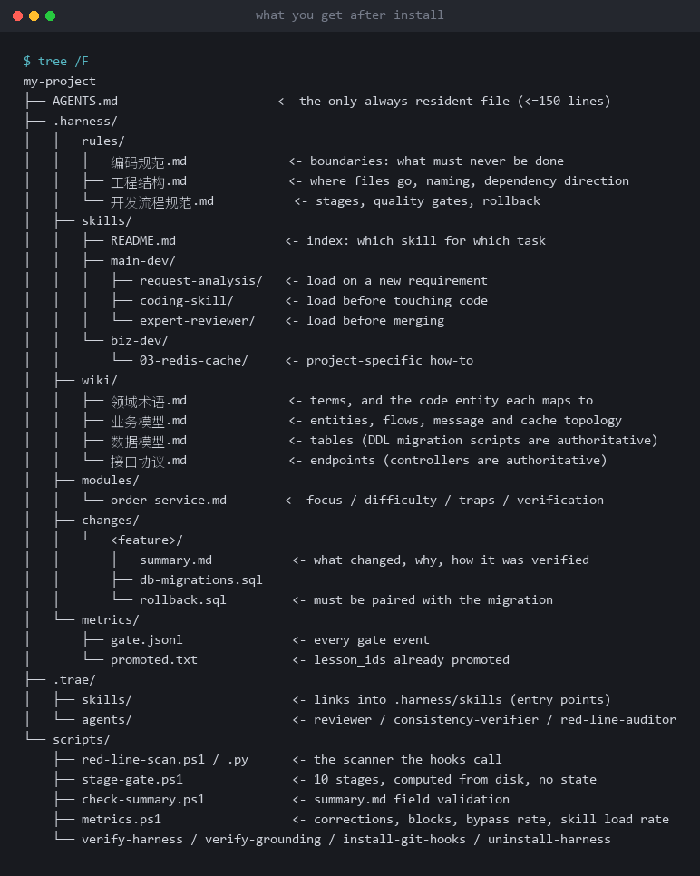
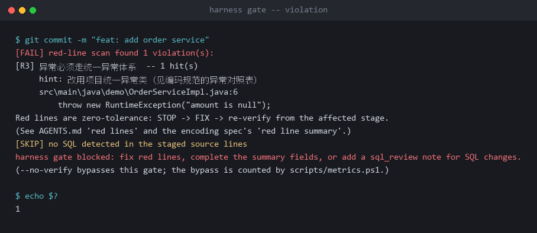
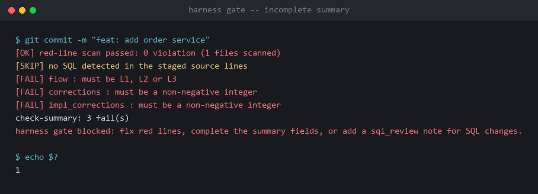
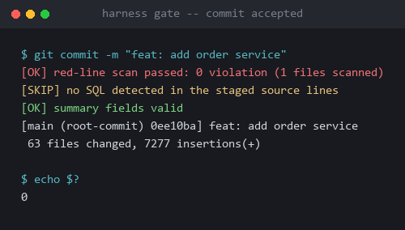

# Harness Lifecycle

Builds and maintains an executable constraint system for AI coding projects: rules, guidance, gates, evidence, metrics and review.

It probes the project and generates `AGENTS.md`, rules, skills and wiki pages from evidence. After that, the conventions are enforced by scripts and git hooks, not by reminders.

[](https://github.com/fengyale/harness-lifecycle/actions/workflows/verify.yml)
[](https://github.com/fengyale/harness-lifecycle/releases)
[](LICENSE)
[](references/平台适配.md)

---

## What it solves

AI writes code fast; delivery is slow. The bottleneck is rarely "it cannot write code", it is the six failure modes below, and "being more careful" does not fix any of them:

| What the failure looks like | Why it keeps happening | How this makes it decidable |
| --- | --- | --- |
| **It compiles, the logic is wrong**: an inverted condition, a missing boundary, a state machine missing one path — and the tests are green | Coding starts before acceptance criteria exist; tests only cover the happy path | `summary.md` states acceptance criteria first; the unit-test skill requires boundaries; review walks a checklist |
| **It works locally, fails in production**: SQL is fine on the dev database, but the production dialect / data volume / indexes differ | The dev schema is treated as production; no plan was ever run | SQL correctness in four layers (syntax / structure / binding / result) + `EXPLAIN` + a read-only sandbox; environment facts live in the wiki and a mismatch fails the gate |
| **Each feature is right, the chain is not**: API fields disagree with the frontend, upstream/downstream protocols are misaligned, a transaction breaks across services | Work stays inside one module; nobody owns the seams | Impact analysis (module card + API protocol + data model); transaction / consistency skills; integration boundaries in the review checklist |
| **Fixed this time, wrong somewhere else next time**: the same trap survives on human memory | Corrections stay in the conversation and never become mechanism | `lesson_id` counting: the second occurrence must become a rule *with a check*; the check declares `fails-when`, otherwise `-LessonGate` rejects it |
| **"Done" without verification**: no compile, no tests, output imagined rather than pasted | Completion is self-reported; there is no exit check | Stage gates really run the commands in `AGENTS.md`; `summary.md` fields are validated; E1/E2 evidence grading rejects invented output |
| **It runs, but nobody dares ship it**: no rollback for the migration, no smoke test, no way to diagnose an incident | Nobody walked the release path end to end | Migration and rollback in pairs, a deploy-verify skill, and pre-release metric/rollback checks |

All six can be decided before delivery. Nobody had written the decision down. `AGENTS.md` is the index, skills carry the how, git hooks and stage gates are the exit check, and `metrics` shows the trend.

> Deeper root-cause analysis: `references/核心论述.md`; the skill and gate behind each failure mode: `docs/usage-and-mechanism.html` section 3.

## Quick start

Let it prove itself before installing anything:

```powershell
git clone https://github.com/fengyale/harness-lifecycle.git
cd harness-lifecycle
powershell -NoProfile -ExecutionPolicy Bypass -File tools\verify-package.ps1
```

Output:

```text
[PASS] parse      36 .ps1 file(s) parse
[PASS] encoding   ASCII without BOM, or UTF-8 with BOM
[PASS] json       4 JSON file(s) parse
[PASS] version    VERSION and releases.json both say <version>
[PASS] structure  required files present, package-only files absent
[PASS] markers    25 template skill(s) carry balanced package/project blocks; 2 harness:upgrade block(s) well formed
[PASS] contract   70 rule/script/doc contract(s) hold
[PASS] docs       README counts, reference numbers and page version match the files
[PASS] smoke      install -> stage 4 -> unfilled summary rejected -> SQL missing/hollow/no-op probes -> uninstall, in a temp copy

package gate: OPEN
```

The 67 contracts check one thing, whether the same rule reads identically in scripts, JSON, `SKILL.md`, `AGENTS.md` and rule files. Changing one copy and leaving the others behind is how this category usually breaks.

Run the behavioural tests:

```powershell
powershell -NoProfile -ExecutionPolicy Bypass -File tests\run-all.ps1
# one suite only (1-3 minutes); the run ends with a per-suite timing table
powershell -NoProfile -ExecutionPolicy Bypass -File tests\run-all.ps1 -Suite test-update
```

Six suites build throw-away projects under `%TEMP%` and assert real exit codes: missing row BLOCKED, placeholder SKIP, compile/test actually executed, pre-commit checking summary fields plus the three content sections (a placeholder table fails), the L1 claim checked against the real diff, three hooks installed and removed, A3+ spoof rejected, upgrade replacing machinery while keeping history, the commit-range summary-order audit, the skill registration check (unindexed / no entry), and the probe fact draft (entities / endpoints / topics / keys / tables).

## Install

### 1. Put it in the skill directory

| Platform | Location |
| --- | --- |
| TRAE | `.trae/skills/harness-lifecycle/` |
| Claude Code | `.claude/skills/harness-lifecycle/` |
| Codex CLI | `.agents/skills/harness-lifecycle/` (subagents live in `.codex/agents/*.toml` and need to be rewritten as TOML) |
| CodeBuddy | `.codebuddy/skills/harness-lifecycle/` (subagents live in `.codebuddy/agents/*.md` and can be reused as is) |
| Other / unknown | Reference `SKILL.md` in index mode |

> **Architecture facade (1.32.0)**: the architecture facade and entry naming are unified; the upgrade script still recognizes historical entries. New installs should use the current entry directory; if a historical entry still exists, confirm the current one loads before removing it. The upgrade script only detects; it never moves or deletes skill directories.

`tools/` is for this package only and is never copied into a project.

### 2. Run `SKILL.md` step 0

The agent probes the platform and the project, then takes one of two paths:

- Existing project: run `probe-project.ps1` and `probe-stack.ps1`, then generate `AGENTS.md`, rules, skills, wiki pages and module cards from evidence.
- New project: confirm background, business and stack first, write `.harness/project-brief.md`, then generate the skeleton.

Both paths follow the grounding protocol: project claims need E1 (a runnable command) or E2 (a real file and line number). Only a new project without code may use E0 (user confirmation), and it must be upgraded once code lands.

### 3. Install the gates

```powershell
powershell -NoProfile -ExecutionPolicy Bypass -File scripts\install-git-hooks.ps1
```

Three hooks:

- `pre-commit`: red-line scan (new lines only), SQL review, summary fields plus the acceptance / impact / task sections, and the L1 claim check;
- `post-commit`: records whether the commit was covered by the gate, used for the bypass rate;
- `pre-merge-commit`: merge commits go through the same gate.

### 4. Verify

```powershell
powershell -NoProfile -ExecutionPolicy Bypass -File scripts\verify-harness.ps1
powershell -NoProfile -ExecutionPolicy Bypass -File scripts\verify-grounding.ps1
powershell -NoProfile -ExecutionPolicy Bypass -File scripts\stage-gate.ps1 -Stage 7 -Feature <name>
```

`verify-*` passing means the structure is correct. A1–A4 and A6 require running a real task; A7 needs two consecutive 14-day windows. The repository does not claim those for you.

### 5. Upgrade an existing install

Do not re-run step 0: it is Copy-Missing and will not replace old scripts. Upgrade by running the bootstrap script from the **new package** (it calls the new package's own `update-harness.ps1`, so the project's old updater is bypassed):

```powershell
# plan only, no files changed
powershell -NoProfile -ExecutionPolicy Bypass -File <new package>\assets\upgrade\upgrade-harness.ps1 `
  -Root <project root> -MergeSkills
# apply
powershell -NoProfile -ExecutionPolicy Bypass -File <new package>\assets\upgrade\upgrade-harness.ps1 `
  -Root <project root> -Apply -MergeSkills
```

`-MergeSkills` lets installed skills pick up new package text: the new template becomes the skeleton and only the `harness:project` blocks are swapped back to the project's own. Matching is by frontmatter `name`, so a directory the project renamed is still found (e.g. `04-sql-review` on disk, `14-sql-review` in the template); a block with no matching section is reported as `PENDING` instead of overwritten. Without it, installed skills are reported as `MANUAL` while the machinery scripts still upgrade.

The upgrade **reinstalls git hooks by default** (the old hook is backed up as `.bak-harness`), which repairs gate rows older than the summary-order guard; `-SkipHooks` keeps the old hooks, and those `verify-harness` gate rows keep failing.

`scripts\*.ps1` / `*.py` is replaced (old files are backed up under `.harness\upgrade\`); `scripts\*.json`, project assets and `.harness\changes|metrics` are kept:

- `AGENTS.md` and `harness-required.json` merge known framework lines/keys only; `-NoMergeKnown` prints the difference instead. Keys outside the whitelist are summarized as one `add N key(s) by hand` line in the dry run (empty arrays / null count as missing); `groundingStrict` is always written as `false` on upgrade; the `summaryContent` arrays (`acceptance` / `impact` / `tasks`) are unioned on upgrade, so renamed package defaults reach older projects while project aliases are kept
- The package's `harness:upgrade` block in `AGENTS.md` (the entry command) is inserted or replaced in place, and an older unmarked copy is replaced instead of duplicated; the `flow-start-command` block in `.harness/rules/开发流程规范.md` is only replaced when the project already has it — when missing it is `MANUAL` and the project rules file is never rewritten
- The red-line summary replaces just the R5/R6 checked cell
- Old L1 summary directories move to the upgrade backup and are deleted after verification; `-KeepL1` keeps them, and L2/L3 history is never touched
- Skill bodies only report a difference by default; `-MergeSkills` swaps back just the `harness:project` blocks, marking `PENDING` when a block cannot be placed or still holds a slot, writing neither (no post-merge line cap). Frontmatter is kept as-is, with one exception: the pre-1.31.8 `description` clause that told the model requirements were already clear (read as permission to skip `request-analysis` and the summary) is replaced with the current one and named in the MERGE detail
- `-UpdateSkills` replaces only uncompiled copies that still contain `slot:`; `-ForceSkills` overrides, but leaves slot-bearing skeletons, so recompile them and run `verify-harness.ps1` again (`-SkipVerify` for the reset step)
- The skill index and `_template` are treated separately, one as a project asset and the other as a package asset

After upgrading, run stages 3/5/7/10 and fill the measured commands in `AGENTS.md`; then run `scripts\verify-harness.ps1 -UpgradeReport` once and work through the files the new package still reports as `MANUAL`.

The first `verify-harness.ps1` after an upgrade may report `skills-registry`: skills that exist in the project but were never indexed or given an entry are now named. They were already unreachable before the upgrade — add them to `.harness\skills\README.md` with a platform entry, or delete the ones no longer in use. `skills-index` normally starts as a `WARN` in an existing install (`AGENTS.md` has no generated marker block yet); run `scripts\sync-skills-index.ps1 -Root . -Write` once. A `FAIL` there means real drift. If the upgrade itself fails, the output now includes the full `Copy-Item` command that restores the backup.

## What you get



```text
AGENTS.md                    the only resident file (<=150 lines): stack, commands, red lines, index, discipline
.harness/
  rules/                     coding conventions, structure, development flow
  skills/                    skill bodies, loaded on demand through platform entries
  wiki/                      domain terms, business model, data model, interfaces
  modules/                   module cards: key points, difficulty, pitfalls, verification
  changes/_small.md          rolling L1 small-change rows (one per task)
  changes/<feature>/         L2/L3 summary.md, migration and rollback scripts
  lessons.md                 shared lesson index (check before writing lesson_id)
  lessons-promoted.txt       promoted lessons (one per line, each must carry check + fails-when)
  metrics/                   gate.jsonl (local gate log)
.trae/                       platform discovery entries: skill links, agents, hooks
scripts/                     probe, scan, stage gate, field checks, metrics, skills index sync, uninstall
```

## How a single task is guided

After installation every task follows the same loading chain, and no rule gets dumped into context up front:

| Layer | Where | When it enters context |
| --- | --- | --- |
| **Resident** | `AGENTS.md`: stack, commands, red lines, file index, mandatory skills | Every turn (≤150 lines) |
| **Trigger** | `name` + `description` of each installed skill (the platform matches only these) | The list is always present; **the body loads only when it matches the task** |
| **Reference** | `.harness/rules`, `wiki`, `modules` pointed to by the skill body | Only when the body tells you to read them |

Example: "add a status filter to the order list query".

1. The index in `AGENTS.md` says "load `request-analysis` on a new requirement" → it produces `summary.md` (requirement / acceptance / impact / split)
2. `coding-skill` matches "start writing code" → its body points to `编码规范.md` and the order module card, and only then are those read
3. SQL is involved → `sql-review` matches → follow the body to `数据模型.md`, run `EXPLAIN`, write the four-layer conclusion into `sql_review:`; a "pass" verdict cannot leave any layer unverified, every cited evidence path must exist, and every data source must appear in the compiled bindings
4. `expert-reviewer` matches before merging → review verdict and "missing capability" go back into `summary.md`
5. On commit, `pre-commit` checks the summary fields and the three content sections (an unfilled acceptance/impact/task table is rejected), the SQL verdict (including "pass while a layer is unverified"), and whether an L1 claim really is one file and 30 lines; stage 10 checks `corrections` / `impl_corrections` / `lesson_id` / `sql_review` and requires a human to confirm a promoted check really turns red for that lesson

Three things keep it from turning into luck.

- **The index is explicit**: the file index and mandatory-skill list in `AGENTS.md` pin down which document a task type must read
- **Triggering is platform-native**: skill bodies are not resident; only a matching `description` loads them, which is why descriptions must use the user's own words and must not overlap
- **Loading is recorded**: `loaded_skills` / `load_skip_reason` are required `summary.md` fields, and `metrics.ps1` computes the load rate — so "it did not trigger when it should" becomes measurable
- **Review can use an independent context**: when the platform has subagents, stage 6 delegates to `code-reviewer` first (it never saw the implementation, only the result); periodic work delegates to `red-line-auditor` (weekly semantic red-line audit) and `consistency-verifier` (monthly doc ↔ code check). Platforms without an agents directory fall back to checklist mode instead of pretending an agent exists

On platforms without auto-discovery, this degrades to `.harness/skills/README.md` as the index plus a mandatory-reading list in the resident file: reliability comes from writing it down, not from platform matching.

A broken loading chain shows up in three ways:

| Symptom | Check first | How |
| --- | --- | --- |
| **It should trigger but does not** | Whether the entry exists, whether `description` uses the user's own words, whether two skills share trigger words | Look for it in the platform skill list; restart and repeat the sentence; `metrics.ps1` shows whether `load_skip_reason` clusters |
| **It triggers but is not followed** | Whether the steps are decidable, whether referenced paths exist, whether the skill has drifted from the code | `verify-grounding.ps1` checks paths and evidence; rewrite "should / try to" into checkable items |
| **The index is missing an entry** | Whether a new rule / wiki page / skill was added to the `AGENTS.md` file index and `skills/README.md` | `skills-registry` in `verify-harness.ps1` (indexed + platform entry) and `skills-index` (generated-table drift, fixed by `sync-skills-index.ps1 -Write`), plus links / frontmatter; the references check in `verify-grounding.ps1` |

> None of the three relies on a feeling: `loaded_skills` and `load_skip_reason` are recorded, and `verify-*` asserts the structure. Tuning trigger words is covered in `references/维护与体检.md` section 3.

## What it changes

- **The resident layer stays small**: `AGENTS.md` stays within 150 lines; details live in rules, wiki pages and module cards loaded on demand.
- **The gate has a real interception point**: git hooks do not depend on an editor; `pre-commit` and `pre-merge-commit` both run the red-line scan, and `post-commit` records bypasses.
- **Stage gates are decidable**: 10 stages; compile and test criteria really run the commands in `AGENTS.md`. A missing row is BLOCKED, a placeholder row is SKIP, a non-zero exit is BLOCKED.
- **Project claims need evidence**: without E1/E2, content may only be written as `TODO(待确认)` and cannot enter a skill body.
- **Lessons persist**: on the 2nd occurrence of a `lesson_id`, the script prompts promotion, and a promotion must become a *rule with a check* — `.harness/lessons-promoted.txt` holds `id :: check=path::note`, the referenced script must declare `# lesson: id` and `# fails-when: what makes this check red`, otherwise `metrics.ps1 -LessonGate` rejects it and stage 10 goes red; if the project has wired that check into CI, CI goes red too (the package ships no CI of its own — wiring is project infrastructure). The lookup index is `.harness/lessons.md`.

## Proof

These outputs come from a real git repository with the gate installed.

**A violation is blocked (exit 1, with line numbers)**



**An incomplete summary is blocked**



**It passes only after the fix (exit 0)**



The case is a 12-module Java system with 182 legacy violations and 2 test files. How the gate went from "always BLOCKED" to actually blocking, and how the first lesson closed the loop, is all in there.

→ [Full case study (Chinese and English) with desensitised excerpts](docs/case-study/README.en.md)

## Difference from template packs

A template pack assumes you know what you need and hands you a set of files. This gathers evidence first, then decides, and ships gates that block, field checks and metrics. A template pack does not check itself; this repository has its own pre-commit, 70 cross-file contracts and behavioural tests.

## Platforms and limits

- **Windows + Windows PowerShell 5.1**: the primary supported path; scripts and tests are validated here.
- **pwsh 7, macOS, Linux**: written for 5.1-compatible syntax; the gate layer runs across OSes, the inspection layer has not been verified per platform. See [platform adapters](references/平台适配.md).
- **Platform discovery**: TRAE `.trae/skills`, Claude Code `.claude/skills`, Codex `.agents/skills`, CodeBuddy `.codebuddy/skills` each get their own entry; when one machine runs several platforms, only the current one is created — the rest are listed with a `setup-links.ps1 -Dest` command instead of being created for you (junctions do not travel with git). Subagents: TRAE `.trae/agents`, Claude `.claude/agents` and CodeBuddy `.codebuddy/agents` reuse the Markdown files directly; Codex uses `.codex/agents/*.toml` and needs a TOML rewrite.
- **Known trade-offs**: the red-line scan covers new lines only, so legacy violations do not block commits; a new project's E0 anchors only emit a WARN after code lands and do not block merges—the first real task must upgrade them to E1/E2.

## Contributing

See [CONTRIBUTING.md](CONTRIBUTING.md). Before changing anything:

```powershell
powershell -NoProfile -ExecutionPolicy Bypass -File tools\verify-package.ps1
powershell -NoProfile -ExecutionPolicy Bypass -File tests\run-all.ps1
# release zip: SKILL.md, VERSION, LICENSE, references/ and assets/ only
powershell -NoProfile -ExecutionPolicy Bypass -File tools\package-zip.ps1
```

## License

MIT. See [LICENSE](LICENSE).
