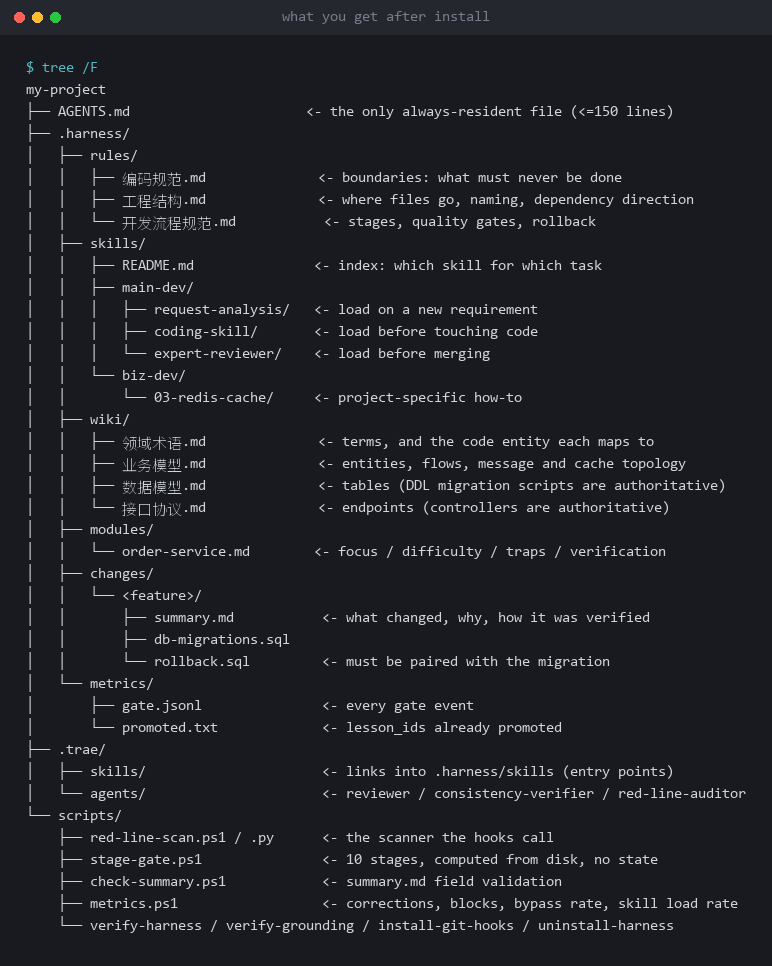
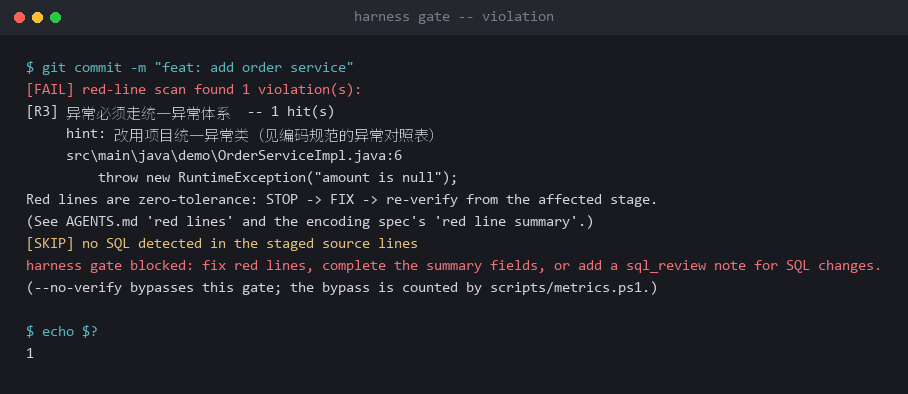
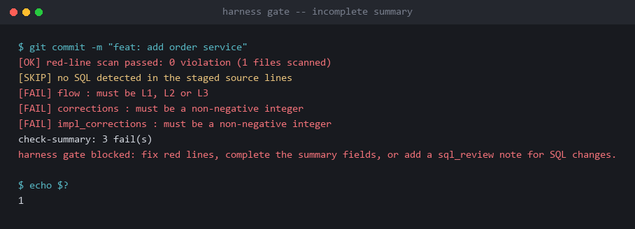
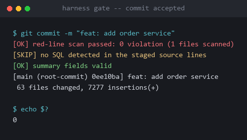

# Harness Bootstrap

给 AI 编程项目安装一套可执行的约束系统：规则、门禁、证据、度量与复盘。

它不是提示词合集，也不是模板包。安装时会探测项目事实，按证据生成 `AGENTS.md`、规则、技能和 wiki；装完之后，项目的约定由脚本和 git hook 执行，而不是靠人每轮提醒。

[](https://github.com/fengyale/harness-bootstrap/actions/workflows/verify.yml)
[](https://github.com/fengyale/harness-bootstrap/releases)
[](LICENSE)
[](references/平台适配.md)

---

## 它解决什么问题

AI 能写出代码，但能不能放心交付是另一回事：漏掉项目里不成文的规矩、说“完成了”其实没编译、同一个错误反复犯。

这套东西把这些判断从“人盯着”变成可执行的门禁和可复查的记录：

| 现状 | 装完之后 |
| --- | --- |
| 项目知识靠人每轮临时补充 | 写进 `AGENTS.md`、规则和 wiki，按需加载，有索引可查 |
| 规范写了，智能体不读 | 出口校验：`summary.md` 字段、阶段门、`verify-*` 会指出来 |
| 门禁靠自觉，`--no-verify` 一绕就过 | git hook 真拦截；绕过会被记录并计入 `bypassRate` |
| 不知道有没有变好 | `metrics.ps1` 看纠正次数、拦截数、技能加载率的趋势 |
| 同一个错误反复犯 | `lesson_id` 第 2 次出现时，脚本提示晋升为规则、门禁或技能 |

## 快速开始

不用先装进项目，先看它能不能自证：

```powershell
git clone https://github.com/fengyale/harness-bootstrap.git
cd harness-bootstrap
powershell -NoProfile -ExecutionPolicy Bypass -File tools\verify-package.ps1
```

输出：

```text
[PASS] parse      21 .ps1 file(s) parse
[PASS] encoding   ASCII without BOM, or UTF-8 with BOM
[PASS] json       4 JSON file(s) parse
[PASS] version    VERSION and releases.json both say <version>
[PASS] structure  required files present, package-only files absent
[PASS] contract   26 rule/script/doc contract(s) hold
[PASS] smoke      install -> stage 4 -> unfilled summary rejected -> uninstall, in a temp copy

package gate: OPEN
```

26 条契约检查的是一件事：同一条规则在脚本、JSON、`SKILL.md`、`AGENTS.md` 和规则文件里是否一致。这个类目最常见的失败方式，是改一处、漂五处。

再看行为测试：

```powershell
powershell -NoProfile -ExecutionPolicy Bypass -File tests\run-all.ps1
```

三套测试会在 `%TEMP%` 建临时项目，验证真实退出码：缺行 BLOCKED、占位 SKIP、编译与测试真跑、pre-commit 只查基础字段、三个 hook 安装与卸载、A3+ 伪造被拒、升级只替换机制文件并保留历史。

## 装到项目

### 1. 放到技能目录

| 平台 | 位置 |
| --- | --- |
| TRAE | `.trae/skills/harness-bootstrap/` |
| Claude Code | `.claude/skills/harness-bootstrap/` |
| Codex 或无子智能体平台 | 按索引模式引用 `SKILL.md`，不复制 agents 目录 |

`tools/` 只用于本包自检，安装时不会复制进项目。

### 2. 让智能体执行 `SKILL.md` 第 0 步

它会先探测平台和项目事实，然后走两条路径之一：

- 存量项目：运行 `probe-project.ps1` 与 `probe-stack.ps1`，按证据生成 `AGENTS.md`、规则、技能、wiki 和模块卡；
- 新项目：先确认背景、业务与选型，产出 `.harness/project-brief.md`，再生成骨架。

两条路径都遵守接地协议：项目断言必须有 E1（可运行命令）或 E2（真实文件与行号）证据；只有新项目无代码阶段允许 E0（用户确认），代码落地后必须升级。

### 3. 安装门禁

```powershell
powershell -NoProfile -ExecutionPolicy Bypass -File scripts\install-git-hooks.ps1
```

三个 hook：

- `pre-commit`：红线扫描（只查新增行）、SQL 评审、summary 基础字段；
- `post-commit`：记录本次提交是否被门禁覆盖，用于计算绕过率；
- `pre-merge-commit`：合并提交同样经过门禁。

### 4. 验收

```powershell
powershell -NoProfile -ExecutionPolicy Bypass -File scripts\verify-harness.ps1
powershell -NoProfile -ExecutionPolicy Bypass -File scripts\verify-grounding.ps1
powershell -NoProfile -ExecutionPolicy Bypass -File scripts\stage-gate.ps1 -Stage 7 -Feature <name>
```

`verify-*` 全绿只代表结构正确。A1–A4、A6 要靠跑一个真实任务来验证；A7 需要两个连续 14 天窗口，仓库不替你下结论。

### 5. 升级已有项目

不要重跑第 0 步：它是 Copy-Missing，旧脚本不会被覆盖。升级走独立入口：

```powershell
# 先看差异，不改文件
powershell -NoProfile -ExecutionPolicy Bypass -File scripts\update-harness.ps1 -PackagePath <新包根目录>
# 确认后执行
powershell -NoProfile -ExecutionPolicy Bypass -File scripts\update-harness.ps1 -PackagePath <新包根目录> -Apply
```

替换 `scripts\*.ps1` / `*.py`（旧文件备份到 `.harness\upgrade\`），保留 `scripts\*.json`、项目资产与 `.harness\changes|metrics`。`AGENTS.md` 与 `harness-required.json` 只自动合并已知框架行/键（`-NoMergeKnown` 退回只打印差异）；红线汇总只替换 R5/R6 的脚本检查格。旧 L1 summary 目录移到升级备份并随验证删除（`-KeepL1` 保留），L2/L3 历史不动。已装技能正文默认只提示差异，确认要同步时加 `-UpdateSkills`。升级后先跑阶段 3/5/7/10，补 `AGENTS.md` 的必跑命令。

## 装完之后



```text
AGENTS.md                    唯一常驻文件（≤150 行）：技术栈、必跑命令、红线、索引、纪律
.harness/
  rules/                     编码规范、工程结构、开发流程
  skills/                    技能正文，按需加载，由平台入口链接
  wiki/                      领域术语、业务模型、数据模型、接口协议
  modules/                   模块卡：重点、难点、坑点、验证方式
  changes/_small.md          L1 小改滚动记录（一行一次）
  changes/<feature>/         L2/L3 summary.md、迁移脚本、回滚脚本
  lessons.md                 教训索引（团队共享，写 lesson_id 前先查）
  lessons-promoted.txt       已晋升教训清单（团队共享）
  metrics/                   gate.jsonl（本机门禁日志）
.trae/                       平台发现入口：skills 链接、agents、hooks
scripts/                     探测、扫描、阶段门、字段校验、度量、卸载
```

## 它改了什么

- **常驻层只保留每轮必读的内容**：`AGENTS.md` 控制在 150 行内，细节放进按需加载的规则、wiki 和模块卡。
- **门禁有真实拦截点**：git hook 不依赖编辑器，`pre-commit` 与 `pre-merge-commit` 都调用红线扫描；`post-commit` 记录绕过。
- **阶段门可判定**：10 个阶段，编译与测试判据会真跑 `AGENTS.md` 里的命令；整行缺失 BLOCKED，占位行 SKIP，退出码非 0 BLOCKED。
- **项目断言要有证据**：没有 E1/E2 的内容只能写 `TODO(待确认)`，不能进技能正文。
- **教训会沉淀**：`lesson_id` 第 2 次出现时脚本提示晋升，写进 `.harness/lessons-promoted.txt`；索引在 `.harness/lessons.md`。

## 证据

下面是在真实 git 仓库里装上门禁后跑出来的输出，不是模拟：

**违规被拦下（退出码 1，精确到行号）**



**summary 字段不完整也被拦下**



**修好之后才通过（退出码 0）**



真实落地案例：一个 12 模块的 Java 系统，182 处存量违规，2 个测试文件。

> 从“门禁永远 BLOCKED”走到“门禁真的在拦人”，以及第一个教训闭环怎么发生。

→ [案例全文（中/英）与脱敏附件](docs/case-study/README.md)

## 和模板包的区别

- 模板包假设你已经知道自己要什么；这个技能先从项目里取证，再决定该有什么。
- 模板包交付的是一组文件；这里交付的是可执行的门禁、字段校验和度量。
- 模板包不检查自己；这个仓库有自己的 pre-commit、26 条跨文件契约和行为测试。

## 平台与限制

- **Windows + Windows PowerShell 5.1**：主要支持路径，脚本与测试在这里验证。
- **pwsh 7、macOS、Linux**：按 5.1 兼容语法编写，门禁层可跨 OS，体检层尚未逐一验证。详见 [平台适配](references/平台适配.md)。
- **平台发现**：TRAE、Claude Code、Codex 或未知平台分别使用对应入口；没有对应目录时，不假装子智能体存在。
- **已知取舍**：红线扫描只覆盖新增行，存量违规不阻塞提交；新项目 E0 在代码落地后只报 WARN 要求升级，不会自动阻止合并，第一个真实任务必须把它换成 E1/E2。

## 参与贡献

见 [CONTRIBUTING.md](CONTRIBUTING.md)。改动前先运行：

```powershell
powershell -NoProfile -ExecutionPolicy Bypass -File tools\verify-package.ps1
powershell -NoProfile -ExecutionPolicy Bypass -File tests\run-all.ps1
```

## License

MIT，见 [LICENSE](LICENSE)。
