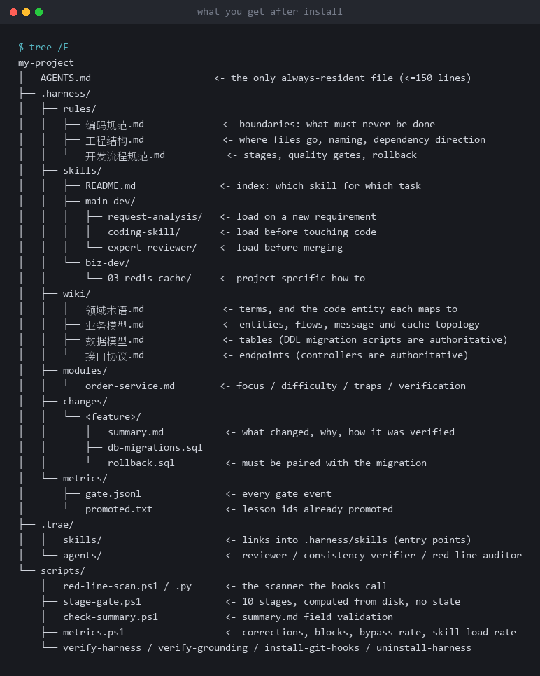
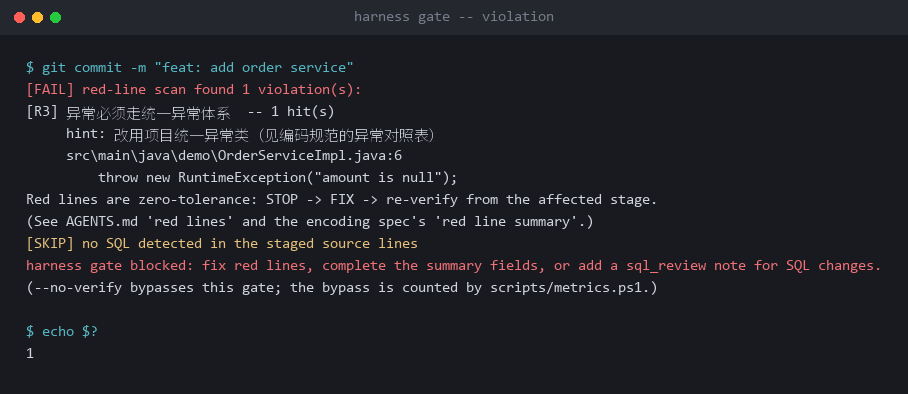
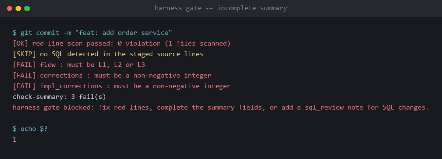
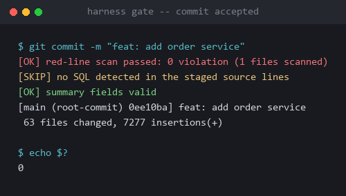

# Harness Lifecycle

给 AI 编程项目搭建并维护一套可执行的约束系统：规则、引导、门禁、证据、度量与复盘。

安装时会探测项目事实，按证据生成 `AGENTS.md`、规则、技能和 wiki。装完之后，约定由脚本和 git hook 执行，不需要每轮提醒。

[](https://github.com/fengyale/harness-lifecycle/actions/workflows/verify.yml)
[](https://github.com/fengyale/harness-lifecycle/releases)
[](LICENSE)
[](references/平台适配.md)

---

## 它解决什么问题

AI 写代码很快，交付慢。慢的地方大多不在"不会写"，而在下面六类失败，靠"更小心"解决不了：

| 失败长什么样 | 为什么反复发生 | 这套东西怎么让它可判定 |
| --- | --- | --- |
| **编译过了，逻辑不对**：条件写反、边界漏一档、状态机少一条路径，测试却是绿的 | 没写验收标准就开写；测试只覆盖 happy path | `summary.md` 先写验收标准；单测技能要求覆盖边界；评审按清单逐条过 |
| **本地跑通，一上线就错**：SQL 在开发库没事，生产库方言 / 数据量 / 索引都不一样 | 把开发库结构当成生产结构；没跑过执行计划 | SQL 正确性四层（语法 / 结构 / 绑定 / 结果）+ `EXPLAIN` + 只读沙箱；环境事实必须来自实测（脚本只能校验占位符、空文件、目录树占位与证据路径，语义真假由评审兜底） |
| **单个功能都对，链路不通**：接口字段和前端对不上、上下游协议没对齐、事务跨服务断了 | 只在单个模块里看，没人负责"接缝" | 影响面分析（模块卡 + 接口协议 + 数据模型）；事务 / 一致性技能；集成边界写进评审清单 |
| **这次改对了，下次换个地方又错**：同一个坑靠人记着 | 纠正只留在对话里，没有落成机制 | `lesson_id` 计数：第 2 次出现就必须晋升成「带检查的规则」——检查里要写 `fails-when`，否则 `-LessonGate` 拒绝 |
| **说"完成了"，其实没验**：没编译、没跑测试、贴的是想象中的输出 | 完成与否靠自述，没有出口校验 | 阶段门真跑 `AGENTS.md` 里的命令；`summary.md` 字段校验；E1/E2 证据分级，编造会被打回 |
| **能跑，但不敢上**：迁移没回滚、没有冒烟、出事定位不了 | 发布路径没人完整走一遍 | 迁移与回滚成对、部署验证技能、上线前的指标与回滚方案检查 |

这六类都能在交付前判定，只是过去没人把判定条件写下来。`AGENTS.md` 给索引，技能给做法，git hook 与阶段门做出口校验，`metrics` 给趋势。

> 更细的病根分析见 `references/核心论述.md`；每类失败对应的技能与门禁见 `docs/usage-and-mechanism.html` 第 3 节。

## 适用边界与已知限制

它不是代码生成器，也不替代人工评审；它把“交付前必须成立的条件”变成可执行的门禁和记录。

- `loaded_skills` 是**结构化自报**，不是平台遥测：调用 Skill 时用 `scripts\record-skill.ps1 -Skill <名>` 追加一条记录，`check-summary` 会交叉校验“声明”与“记录”是否一致（缺记录只报 WARN）。它证明的是“有一次结构化申报”，不能证明模型真的读过文件；`metrics.ps1` 的加载率仍来自 summary 自报。
- 阶段 5/7 在**没有可执行测试命令**时，`summary.md` 必须写 `test_skip_reason`，结果降为 `WARN`；没有原因仍 `FAIL`。`WARN` 不是 `PASS`，报告会单独计数。模块级测试命令失败时，若 `test_skip_reason` 点名该模块，也可降为 `WARN`（只豁免 touched 模块自己声明的命令，整树失败不可豁免）。
- `harness-start` 支持项目自配环境体检：`scripts/harness-required.json` 的 `mcpProbe.entries` 每项 `{name, command}`（command 是一次廉价可达性检查，exit 0 = 可达）；不可达打 `WARN` 与处置提示，entries 为空不探测。
- `suggest-flow` 默认按当前特性（`.git/harness-current-task` 或 `-Feature`）过滤；模块名来自模块卡或路径推断，属于候选，不是项目真相。
- `harness-start` 的重复检测是**关键词 + 路径证据**，不是代码级重复分析；`path-match` 比 `keyword-only` 更值得优先核对。
- 阶段门校验结构、计数和证据路径；结论的语义真假仍由评审兜底。

## 快速开始

装之前先让它自证一次：

```powershell
git clone https://github.com/fengyale/harness-lifecycle.git
cd harness-lifecycle
powershell -NoProfile -ExecutionPolicy Bypass -File tools\verify-package.ps1
```

输出：

```text
[PASS] parse      37 .ps1 file(s) parse
[PASS] encoding   ASCII without BOM, or UTF-8 with BOM
[PASS] json       4 JSON file(s) parse
[PASS] version    VERSION and releases.json both say <version>
[PASS] structure  required files present, package-only files absent
[PASS] markers    25 template skill(s) carry balanced package/project blocks; 2 harness:upgrade block(s) well formed
[PASS] contract   76 rule/script/doc contract(s) hold
[PASS] docs       README counts, reference numbers and page version match the files
[PASS] smoke      install -> stage 4 -> unfilled summary rejected -> SQL missing/hollow/no-op probes -> uninstall, in a temp copy

package gate: OPEN
```

76 条契约只查一件事，同一条规则在脚本、JSON、`SKILL.md`、`AGENTS.md` 和规则文件里是否一致。这类改动最常见的失手方式，是改一处、漂五处。

再看行为测试：

```powershell
powershell -NoProfile -ExecutionPolicy Bypass -File tests\run-all.ps1
# 只跑一套（约 1–3 分钟），输出末尾会打印每套耗时
powershell -NoProfile -ExecutionPolicy Bypass -File tests\run-all.ps1 -Suite test-update
```

六套测试会在 `%TEMP%` 建临时项目，验证真实退出码：缺行 BLOCKED、占位 SKIP、编译与测试真跑、pre-commit 查 summary 字段与三节内容（占位符算未填）、L1 声明按真实 diff 核对、三个 hook 安装与卸载、A3+ 伪造被拒、升级只替换机制文件并保留历史、提交区间反序审计、技能注册检查（漏登记 / 缺入口）、探测事实草稿（实体 / 端点 / Topic / Key / 表名）。

## 装到项目

### 1. 放到技能目录

| 平台 | 位置 |
| --- | --- |
| TRAE | `.trae/skills/harness-lifecycle/` |
| Claude Code | `.claude/skills/harness-lifecycle/` |
| Codex CLI | `.agents/skills/harness-lifecycle/`（子代理在 `.codex/agents/*.toml`，需按 TOML 重写） |
| CodeBuddy | `.codebuddy/skills/harness-lifecycle/`（子代理在 `.codebuddy/agents/*.md`，可直接复用） |
| 其它 / 不确定 | 按索引模式引用 `SKILL.md` |

> **架构门面说明（1.32.0）**：统一架构门面与入口命名；历史入口仍可被升级脚本识别。新装请使用当前入口目录；如果历史入口还在，先确认当前入口能正常加载，再删除历史入口。升级脚本只识别、不移动、不删除技能目录。
> 全局安装同理：先把本版装到 `~/.trae-cn/skills/harness-lifecycle/`（或对应平台的全局技能目录），确认能加载后再删旧的 `harness-bootstrap/`；升级脚本不碰全局目录。

`tools/` 只用于本包自检，不进安装包。

### 2. 让智能体执行 `SKILL.md` 第 0 步

它会先探测平台和项目事实，然后走两条路径之一：

- 存量项目：运行 `probe-project.ps1` 与 `probe-stack.ps1`，按证据生成 `AGENTS.md`、规则、技能、wiki 和模块卡；
- 新项目：先确认背景、业务与选型，产出 `.harness/project-brief.md`，再生成骨架。

两条路径都遵守接地协议：项目断言必须有 E1（可运行命令）或 E2（真实文件与行号）证据；只有新项目无代码阶段允许 E0（用户确认），代码落地后必须升级。

### 3. 安装门禁

```powershell
powershell -NoProfile -ExecutionPolicy Bypass -File scripts\install-git-hooks.ps1
```

三个 hook：

- `pre-commit`：红线扫描（只查新增行）、SQL 评审、summary 字段与验收标准/影响面/任务拆分三节内容、L1 声明核对；
- `post-commit`：记录本次提交是否被门禁覆盖，用于计算绕过率；
- `pre-merge-commit`：合并提交同样经过门禁。

### 4. 验收

```powershell
powershell -NoProfile -ExecutionPolicy Bypass -File scripts\verify-harness.ps1
powershell -NoProfile -ExecutionPolicy Bypass -File scripts\verify-grounding.ps1
powershell -NoProfile -ExecutionPolicy Bypass -File scripts\stage-gate.ps1 -Stage 7 -Feature <name>
```

`verify-*` 全绿只代表结构正确。A1–A4、A6 要靠跑一个真实任务来验证；A7 需要两个连续 14 天窗口，仓库不替你下结论。

### 5. 升级已有项目

不要重跑第 0 步：它是 Copy-Missing，旧脚本不会被覆盖。升级从**新包**运行引导脚本（它调用新包自带的 `update-harness.ps1`，项目里的旧 updater 被绕过）：

```powershell
# 先看差异，不改文件
powershell -NoProfile -ExecutionPolicy Bypass -File <新包>\assets\upgrade\upgrade-harness.ps1 `
  -Root <项目根> -MergeSkills
# 确认后执行
powershell -NoProfile -ExecutionPolicy Bypass -File <新包>\assets\upgrade\upgrade-harness.ps1 `
  -Root <项目根> -Apply -MergeSkills
```

`-MergeSkills` 让已装技能跟进新版正文：以新模板为骨架，只把 `harness:project` 区块换回项目自己的。**按 frontmatter 的 `name` 匹配**，所以目录被项目改过名也能找到（如项目里的 `04-sql-review` 对应模板的 `14-sql-review`）；找不到对应章节就标 `PENDING`，不会覆盖。不加 `-MergeSkills` 时已装技能只报 `MANUAL`，机制脚本照常升级。

升级默认**重装 git hook**（旧 hook 备份为 `.bak-harness`），能把早于 summary-order guard 的 gate 行修好；`-SkipHooks` 保留旧 hook，此时 `verify-harness` 的 gate 行会继续失败。

替换 `scripts\*.ps1` / `*.py`（旧文件备份到 `.harness\upgrade\`），保留 `scripts\*.json`、项目资产与 `.harness\changes|metrics`：

- `AGENTS.md` 与 `harness-required.json` 只自动合并已知框架行/键，`-NoMergeKnown` 退回只打印差异；白名单外的键会在 dry-run 汇总成 `add N key(s) by hand`（空数组 / null 视为缺失），`groundingStrict` 升级固定写 `false`；`summaryContent` 的 `acceptance` / `impact` / `tasks` 三个数组升级时取并集，包内重命名的默认章节会补进老项目，项目自定义别名保留
- `AGENTS.md` 里包自带的 `harness:upgrade` 标记块（「开工第一件事」命令）自动插入或原地替换，旧的无标记副本会被换掉而不是重复一遍；`.harness/rules/开发流程规范.md` 的 `flow-start-command` 块只在项目已有时替换，缺失时标 `MANUAL`，不自动改写项目规则文件
- 红线汇总只替换 R5/R6 的脚本检查格
- 旧 L1 summary 目录移到升级备份、随验证删除，`-KeepL1` 保留；L2/L3 历史不动
- 技能正文默认只提示差异；`-MergeSkills` 只换回项目自己的 `harness:project` 区块，定位不到或仍有 slot 标 `PENDING`（不设合并后行数上限），都不写盘；frontmatter 默认原样保留，唯一例外是 1.31.8 前 `description` 里那句「需求已明确…」（会被读成可以跳过 `request-analysis` 和 summary），命中即换成新版 description，并在 MERGE 明细里点名
- `-UpdateSkills` 只替换仍含 `slot:` 的未编译副本；`-ForceSkills` 才强制覆盖，但覆盖后是含 slot 的骨架，要重新编译再跑 `verify-harness.ps1`（重置那一步可配 `-SkipVerify`）
- 技能索引与 `_template` 分开对待：前者是项目资产，后者是包资产

升级后先跑阶段 3/5/7/10，补 `AGENTS.md` 的必跑命令；再跑一次 `scripts\upgrade-report.ps1 -Root <项目根>`，看 8 项激活状态：

- `[ACTIVE]`：已生效，盘上有证据；
- `[MANUAL]`：项目还要动手，例如 `requireTaskStart` 仍是 `false`、流程规范的 `flow-start-command` 块还没补；
- `[MISSING]`：包内产物缺失、为空或仍是 stub。

加 `-Strict` 时任一 `MISSING` 退出 1，适合提交前对齐与 CI。`scripts\verify-harness.ps1 -UpgradeReport` 仍可用，报告口径与它一致。

多仓工作区（前端 / 后端各装一份）在工作区根放 `harness.workspace.json`（示例：`assets\upgrade\harness.workspace.example.json`），用 `assets\upgrade\upgrade-workspace.ps1 -Root <工作区根>` 一条命令逐仓处理：`-Install` 给未装的仓拷模板，`-Strict` 在任一分仓失败、`-Apply` 后报告仍有 `MISSING` 或各仓 `.harness\.installed-version` 不一致时退出 1。

升级脚本只管项目内资产：全局技能目录不移动、不删除。全局安装迁移时，先把本版装到 `harness-lifecycle` 目录，确认平台能发现并加载，再删旧的 `harness-bootstrap`。

升级后第一次跑 `verify-harness.ps1` 可能报 `skills-registry`：老项目里存在、但从未登记或建入口的技能会被点名。它们此前一直不可达，不是升级弄坏的——按提示补 `.harness\skills\README.md` 登记与平台入口，或删除不再使用的技能目录。`skills-index` 在存量项目里通常先报 `WARN`（`AGENTS.md` 还没有生成标记块），跑一次 `scripts\sync-skills-index.ps1 -Root . -Write` 即可；报 `FAIL` 才是真有漂移。若升级本身失败，输出里会带上从备份恢复的完整 `Copy-Item` 命令。

## 装完之后



```text
AGENTS.md                    唯一常驻文件（≤150 行）：技术栈、必跑命令、红线、索引、纪律
.harness/
  rules/                     编码规范、工程结构、开发流程
  skills/                    技能正文，按需加载，由平台入口链接
  wiki/                      领域术语、业务模型、数据模型、接口协议
  modules/                   模块卡：重点、难点、坑点、验证方式
  changes/_small.md          L1 小改滚动记录（一行一次）
  changes/<feature>/         L2/L3 summary.md、迁移脚本、回滚脚本
  lessons.md                 教训索引（团队共享，写 lesson_id 前先查）
  lessons-promoted.txt       已晋升教训清单（团队共享；每条必须带 check + fails-when）
  metrics/                   gate.jsonl（本机门禁日志）
.trae/                       平台发现入口：skills 链接、agents、hooks
scripts/                     探测、扫描、阶段门、字段校验、度量、技能清单同步、卸载
```

### 多模块：编译与测试按模块跑

`AGENTS.md` 的「必跑命令」表可以有可选的「模块」列：`| 用途 | 模块 | 命令 |`。模块名与 `.harness/modules/` 的卡片名一致，`*` 表示任何模块都适用的默认行。

- 阶段 3/5/7/8 按 `summary.md` 的 `touched_modules` 取并集，逐个模块跑对应的编译 / 测试命令；
- 缺该模块的行且没有 `*` 行 → FAIL；有模块列但 `touched_modules` 为空 / none 且没有 `*` 行 → 同样 FAIL；
- 只有单条命令、没有模块列的旧表只 WARN，并提示补模块列。

单模块项目保持一行一条即可；不要把所有模块塞进一条固定命令——多模块改动只会跑到其中一个。

## 开工一条命令

需求进来先跑：

```powershell
powershell -NoProfile -ExecutionPolicy Bypass -File scripts\harness-start.ps1 `
  -Feature order-export -Requirement "导出订单到 Excel"
```

一条命令做完四件事：打印 `harness-plan` 的上下文包（相关模块卡、必上技能、预计门禁、涉及表 / 接口）、按模板建 `summary.md` 骨架并预填 `flow` / `touched_modules`、跑 `stage-gate.ps1 -Stage 1`、通过后写 `.git/harness-task-started`。Stage 1 不过就不写 marker、退出码非 0，此时不得 Edit/Write 源码。

| 参数 | 用途 |
| --- | --- |
| `-Investigation` | 只读排查型记录：`flow: L1` + `record_kind: investigation` + `delivery_status: 不适用`，验收 / 影响 / 任务三节不强制 |
| `-Flow L1/L2/L3` / `-Modules a,b` | 显式指定档位与模块；不传时用 plan 的建议，显式参数优先 |
| `-SkipPlan` | 不打印上下文包，只建记录 + 过 Stage 1 |
| `-SkipPreflight` | 跳过只读 pre-flight（git status / diff --stat / 最近提交 / 需求关键词命中历史） |

`requireTaskStart` 默认 `false`：新装和升级都不启用，L0 / 纯文档 / harness-only / merge 提交不受影响。团队采用这个入口后，把它改成 `true`，pre-commit 才只在提交 `.harness/changes/<特性>/summary.md` 时校验 marker（必须存在、特性名一致、晚于上次提交）。

### 什么时候跑什么

| 时机 | 命令 | 说明 |
| --- | --- | --- |
| 开工 | `scripts\harness-start.ps1 -Feature <name> -Requirement "<需求原文>"` | L2/L3 的第一条命令；`requireTaskStart` 的 pre-commit 硬校验默认关闭，采用后建议常开 |
| 需求 / 模块 / 门禁预判 | `scripts\harness-plan.ps1 -Requirement "..."` | `harness-start` 内部会跑；也可单独跑，只读 |
| 改动之后 | `scripts\suggest-flow.ps1 [-Feature <名>]` | 按真实 diff 给 L0–L3，并预填 `flow:` / `touched_modules:`；默认按当前特性过滤，避免整仓未提交改动干扰 |
| 阶段门 | `scripts\stage-gate.ps1 -Stage 1/3/5/6/7/10 -Feature <name>` | 编译 / 测试判据真跑 `AGENTS.md` 的命令 |
| 收尾 | `scripts\stage-gate.ps1 -Stage 10 -Feature <name>` | 先跑一次 `metrics.ps1` 刷新 `lessons.md` / `reviews.md`，再跑 lesson 门禁（1.31.25 起） |
| 看指标 | `scripts\metrics.ps1` | 四个代理指标；无数据标 `n/a` / `unknown` |
| 升级 | `assets\upgrade\upgrade-harness.ps1 -Root <项目>`；`scripts\upgrade-report.ps1 -Root <项目>` | 见「升级已有项目」 |
| 结构自检 | `scripts\verify-harness.ps1`；`scripts\verify-grounding.ps1` | 全绿只代表结构正确 |

## 一次任务是怎么被引导的

装完之后，每个任务走同一条加载链，不会把所有规范一次性塞进上下文：

| 层 | 在哪里 | 什么时候进上下文 |
| --- | --- | --- |
| **常驻** | `AGENTS.md`：技术栈、必跑命令、红线、文件索引、必上技能 | 每轮都在（≤150 行） |
| **触发** | 已装技能的 `name` + `description`（平台只按这两个匹配） | 技能清单每轮在场；**命中当前任务才加载正文** |
| **引用** | 技能正文里指到的 `.harness/rules`、`wiki`、`modules` | 正文让你读时才读 |

以「给订单列表加一个按状态过滤的查询」为例：

1. `AGENTS.md` 的「开工第一件事」让你先跑 `harness-start` → 上下文包列出订单模块卡与必上技能，`summary.md` 骨架已建好（`flow` / `touched_modules` 已预填），Stage 1 已 OPEN
2. `request-analysis` 命中 → 补齐 `summary.md` 的需求 / 验收 / 影响面 / 任务拆分
3. 动代码时 `coding-skill` 命中"开始写代码" → 正文指向 `编码规范.md` 和订单模块卡，这时才读这两份；改完先跑 `suggest-flow.ps1`，用它的 `flow:` / `touched_modules:` 校正记录
4. 涉及 SQL → `sql-review` 命中 → 按正文查 `数据模型.md`、跑 `EXPLAIN`、把四层结论写进 `sql_review:`；结论写「通过」时四层不得留「未验证」，引用的证据路径必须存在、数据源必须在编译后的绑定里
5. 合并前 `expert-reviewer` 命中 → 评审结论写回 `summary.md` 的「评审结论」表（严重度 / 范围 / 状态 / 指纹 / 问题 / 证据 / 处置），P0 必须已修、P1 必须有处置
6. 提交时 `pre-commit` 校验 summary 字段与三节内容（验收标准/影响面/任务拆分留占位符即拒）、SQL 结论（含"结论通过但四层未验证"的矛盾），并核对 L1 声明是否真的只有 1 文件 / 30 行；阶段 10 校验 `corrections` / `impl_corrections` / `lesson_id` / `sql_review` / `delivery_status` / `linked_records`，并要求人工确认晋升的检查真的会因该教训变红

保证它不退化成"看运气"的是三件事：

- **索引是显式的**：`AGENTS.md` 的「文件索引」和「必上技能」写死哪类任务读哪份，不靠模型自由发挥
- **触发是平台原生的**：技能正文不常驻，只有 `description` 匹配当前任务才加载；所以 `description` 要写用户会说的话，且技能之间不能重叠
- **加载有记录**：`loaded_skills` 是 `summary.md` 必填字段；写成 `none` 时还必须填 `load_skip_reason`（写成 `none, because …` 就算给了理由）。`metrics.ps1` 统计的是**这些自报字段**里的加载率——它能暴露"该触发不触发"，但无法证明模型真的读过该文件
- **评审可换独立上下文**：平台支持子智能体时，流程第 6 步优先委派 `code-reviewer`（看不到实现过程，只看变更结果）；周期性任务分别委派 `red-line-auditor`（每周红线语义审计）与 `consistency-verifier`（每月文档 ↔ 代码核对）。没有 agents 目录的平台走清单模式，不假装它存在

平台没有自动发现能力时（未知工具），退化为 `.harness/skills/README.md` 当索引 + 常驻文件写死必读清单：可靠性靠"写清楚"，不靠平台匹配。

加载链断了通常只有三种样子，按症状查：

| 症状 | 先查什么 | 怎么查 |
| --- | --- | --- |
| **该触发不触发** | 入口是否建了、`description` 是否写了用户原话、是否和别的技能撞词 | 平台技能列表里有没有它；重启后重发一句原话；翻 `summary.md` 的 `load_skip_reason` 是否集中出现（`metrics.ps1` 不读该字段） |
| **触发了不照做** | 正文步骤是否可判定、指向的路径是否存在、技能是否已和代码脱节 | `verify-grounding.ps1` 查路径与证据；正文里"应该/尽量"这类词改成可勾选的检查项 |
| **索引漏登记** | 新增的规则 / wiki / 技能有没有回到 `AGENTS.md` 文件索引和 `skills/README.md` | `verify-harness.ps1` 的 `skills-registry`（登记 + 平台入口）与 `skills-index`（生成表漂移，跑 `sync-skills-index.ps1 -Write` 修）、links / frontmatter；`verify-grounding.ps1` 的 references |

> 三种症状都不靠"感觉"：`check-summary` 会拦缺字段的 summary，`verify-*` 会查结构与证据；但"加载率"是自报值，别把它当遥测。

## 交付与记录

- **交付状态必须表达到终态**：`delivery_status` 四值——`已交付未提交` / `已提交未部署` / `已部署` / `不适用`。写 `已部署` 时，部署记录表必须至少有一行真实内容（时间 / 环境 / 版本 / 验证人 / 结果）；其余三值可写「不适用」或留空说明。
- **跨仓记录**：跨仓特性在每个仓库各留一份 `summary.md`，用 `linked_records: <repo:path 或 URL>` 指向另一个仓库；无跨仓写 `-`。整行缺失视为单仓（不算未完成），但写占位符会 FAIL；门禁不校验对端仓库。
- **证据目录**：`.harness/changes/<特性>/evidence/` 放编译日志、`EXPLAIN`、查询结果摘要、截图；`summary.md` 只引用路径，不贴长输出。除已有的 `sql_review` 证据锚点外不新增硬门禁。

### 评审台账

评审结论写进 `summary.md` 的「评审结论」表，固定 7 列：

| 严重度 | 范围 | 状态 | 指纹 | 问题 | 证据 | 处置 |
| --- | --- | --- | --- | --- | --- | --- |

- P0 必须 `已修`；P1 必须有处置（`已修` / `转待办` / `接受`）；
- P0 / P1 必须带 kebab-case 指纹，写前先查 `.harness/reviews.md`，同一问题复用同一指纹；
- `.harness/reviews.md` 是 `metrics.ps1` 生成的跨任务索引（团队共享），收尾时刷新；
- `reviewLedgerStrict`：新装 `true`（缺表或表格式坏直接 FAIL），升级项目 `false`（缺表只 WARN，补完第一张表后手动改 true）。

### 四指标

`metrics.ps1` 从 `summary.md` 的 `corrections` / `impl_corrections` / `loaded_skills` / `lesson_id` 和 `gate.jsonl` 算出四个代理值：

| 指标 | 口径 |
| --- | --- |
| 一次通过率 | 归属该任务的门禁事件里没有 `blocked=1` 即为通过；没有归属事件的标 `unknown`，不当作通过 |
| 门禁往返 | 每个任务的 `blocked=1` 次数均值，附 0 / 1 / 2+ 分布 |
| lead time | `summary.md` 日期 → 最后一次改动该记录目录的提交，按天 |
| 复用率 | 同一技能被 ≥2 个任务加载时，第二个任务的纠正或往返是否更少；只出现一次的技能标 `n/a` |

无数据一律标 `n/a` / `unknown`，不造数。`metrics.ps1 -SelfTest` 在临时仓库里验一遍口径。

## 它改了什么

- **常驻层只保留每轮必读的内容**：`AGENTS.md` 控制在 150 行内，细节放进按需加载的规则、wiki 和模块卡。
- **门禁有真实拦截点**：git hook 不依赖编辑器，`pre-commit` 与 `pre-merge-commit` 都调用红线扫描；`post-commit` 记录绕过。
- **阶段门可判定**：10 个阶段，编译与测试判据会真跑 `AGENTS.md` 里的命令；整行缺失 BLOCKED，占位行 SKIP，退出码非 0 BLOCKED。
- **项目断言要有证据**：没有 E1/E2 的内容只能写 `TODO(待确认)`，不能进技能正文。
- **教训会沉淀**：`lesson_id` 第 2 次出现时脚本提示晋升；晋升必须写成「带检查的规则」——`.harness/lessons-promoted.txt` 里 `id :: check=路径::说明`，被指向的脚本里要有 `# lesson: id` 与 `# fails-when: 什么改动会让它变红`，否则 `metrics.ps1 -LessonGate` 拒绝，阶段 10 会红；若项目已把该检查接进 CI，CI 也会红（本包不自带 CI，接线属项目基础设施）。索引在 `.harness/lessons.md`。

## 证据

下面的输出来自一个装好门禁的真实 git 仓库。

**违规被拦下（退出码 1，精确到行号）**



**summary 字段不完整也被拦下**



**修好之后才通过（退出码 0）**



真实案例是一个 12 模块的 Java 系统，182 处存量违规，2 个测试文件。门禁怎么从"永远 BLOCKED"变成真的在拦人，第一个教训闭环怎么发生，都写在里面。

→ [案例全文（中/英）与脱敏附件](docs/case-study/README.md)

## 和模板包的区别

模板包假设你知道自己要什么，交给你一组文件。这里先从项目取证再决定该有什么，交付的是能拦人的门禁、字段校验和度量。模板包不检查自己，这个仓库有自己的 pre-commit、76 条跨文件契约和行为测试。

## 平台与限制

- **Windows + Windows PowerShell 5.1**：主要支持路径，脚本与测试在这里验证。
- **pwsh 7、macOS、Linux**：按 5.1 兼容语法编写，门禁层可跨 OS，体检层尚未逐一验证。详见 [平台适配](references/平台适配.md)。
- **平台发现**：TRAE `.trae/skills`、Claude Code `.claude/skills`、Codex `.agents/skills`、CodeBuddy `.codebuddy/skills` 各自建入口；一台设备有多个平台时，只建当前平台，其余列出来并给 `setup-links.ps1 -Dest` 命令，不代建（junction 不入库）。子代理：TRAE `.trae/agents`、Claude `.claude/agents`、CodeBuddy `.codebuddy/agents` 可直接复用 Markdown；Codex 用 `.codex/agents/*.toml`，需按 TOML 重写。
- **已知取舍**：红线扫描只覆盖新增行，存量违规不阻塞提交；新项目 E0 在代码落地后只报 WARN 要求升级，不会自动阻止合并，第一个真实任务必须把它换成 E1/E2。

## 参与贡献

见 [CONTRIBUTING.md](CONTRIBUTING.md)。改动前先运行：

```powershell
powershell -NoProfile -ExecutionPolicy Bypass -File tools\verify-package.ps1
powershell -NoProfile -ExecutionPolicy Bypass -File tests\run-all.ps1
# 打发布包：只收 SKILL.md / VERSION / LICENSE / references / assets（可安装资产）
powershell -NoProfile -ExecutionPolicy Bypass -File tools\package-zip.ps1
```

## License

MIT，见 [LICENSE](LICENSE)。
