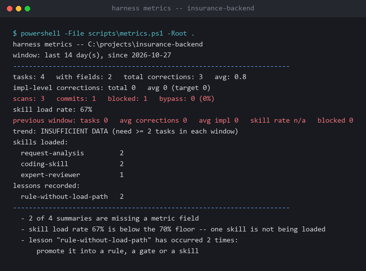
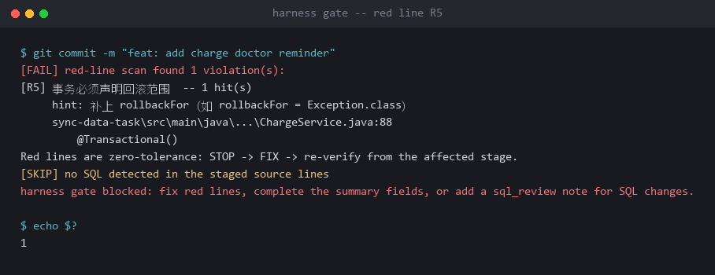

# Case study: landing a harness on a 12-module Java insurance quality-control backend

> A record from a real existing codebase. Project name, datasource addresses,
> credential locations and vendor names are desensitised; the stack, the
> structure, the rules and the decision trail are unchanged.
>
> [中文版](README.md)

---

## 1. Where it started

| | |
|---|---|
| System | Insurance quality-control backend (real-time compliance checks on HIS orders and fees) |
| Stack | Java 8 · Spring Boot 2.0.6 · **JFinal ORM** (not MyBatis/JPA) · Oracle + MSSQL + Redis · Maven, 12 modules |
| Tests | **2 `*Test.java` files in the whole repository** |
| Legacy red-line violations | **182** |
| Existing rule files | none |

This was neither a greenfield project nor a tidy existing one. Three properties
made most solutions quit on the spot:

1. **The ORM is JFinal**, so every `@Mapper` / XML-mapping rule in the template
   pack was dead on arrival.
2. **182 historical violations.** The first scan reported 182 findings, which
   means any gate that blocks on a full scan gets switched off within the hour.
3. **Almost no tests.** "Run the tests" could not serve as an automatic gate
   criterion for months.

---

## 2. Cold start: 9 skills, not 25

The installed skill set:

```
main-dev/         request-analysis · coding-skill · expert-reviewer · soap-endpoint-verify
biz-dev/          03-redis-cache · 04-sql-review · 05-transaction-consistency · rule-engine
trouble-shooting/ 01-slow-sql
```

Nine, not twenty-five. The cold-start budget is 8 (hard cap); a few of these
were added later, on demand.

More important: **every skill carries evidence anchors.** This is what the
grounding protocol requires:

```markdown
## Evidence

- [E2] cost-control-chronic/src/main/java/.../MenTeService.java :: the only @Transactional and the chronic-disease implementation
- [E2] .trae/rules/project_rules.md :: drug-ratio and discharge-mode exclusion rules
```

The rule: **no project-specific claim may enter a skill body without E1 (a
runnable command) or E2 (a real file + line number).** Without evidence it goes
to `TODO(待确认)` and stays there.

What that buys you shows up in `excerpt/.harness/modules/cost-control-chronic.md`:

> Also **the only module in the repository that uses `@Transactional`** — take the
> transaction style from it.
>
> The drug-ratio calculation must exclude cases whose diagnosis starts with **Z51**.
>
> Assuming the exclusion always applies → the dictionary switch actually defaults
> to '0' (off).

Nobody writes that from a generic template. It comes from reading the code.

---

## 3. Trimming the red lines: turning three off on purpose

The template pack offers 8 candidate red lines. This project **enabled 4**, and
`AGENTS.md` says why:

| # | Red line | State |
|---|---|---|
| R1 | money as integer minor units | ❌ **off** |
| R2 | cache keys carry a fixed prefix | ❌ **off** |
| R3 | exceptions go through one hierarchy | ✅ on |
| R4 | no field injection | ✅ on |
| R5 | transactions declare rollback scope | ✅ on |
| R6 | no secrets in logs | ✅ on |
| R7 | no `${}` in Mapper XML | ❌ **off** |

> **R1 / R2 / R7 are not enabled**: this project has 0 XML mapping files (JFinal),
> and cache keys are uniformly wrapped in `RedisUtils` — **enabling them would only
> produce false positives**.

This is the single most important lesson in the case:

> **A red line that cannot be judged accurately by a machine is not a constraint,
> it is noise.**
> A rule with a high false-positive rate trains people to reach for
> `--no-verify` — and once that becomes the default, every gate you installed is
> worth zero.

So trimming the red lines is **design work, not a compromise**. What remained in
`red-line-rules.json` was four:

```json
{
  "id": "R3",
  "name": "exceptions go through one hierarchy",
  "pattern": "throw\\s+new\\s+(RuntimeException|IllegalStateException|IllegalArgumentException|Exception)\\b",
  "include": ["*.java"],
  "hint": "use the project's unified exception handling (see the global handler in the aspect module)"
}
```

---

## 4. What happened the first time the gate really ran

`excerpt/.harness/metrics/gate.jsonl` holds the real events. There are four:

```json
{"event":"scan","ts":"2026-10-27T14:18:34Z","blocked":0,"files":0,"hunks":0}
{"event":"scan","ts":"2026-10-29T13:54:34Z","blocked":1,"files":4,"hunks":7}
{"event":"scan","ts":"2026-10-29T15:36:59Z","blocked":0,"files":4,"hunks":7}
{"event":"commit","ts":"2026-10-29T15:37:00Z","hash":"7875cd51","scanned":1}
```

How to read it:

- **10-27** first scan, 0 violations — the result of "new lines only" working
- **10-29** **1 violation blocked** (4 files, 7 hunks)
- **the same files** scanned again, 0 violations — so the violation was fixed
- **then the commit, `scanned: 1`** — this commit really was covered by the gate

That last field is written by `post-commit`. Its purpose is to compute a
**bypass rate**: if the team starts using `--no-verify`, `scanned` goes to 0 and
`metrics.ps1` reports it.



> **Without the post-commit counter, you never learn that your gate has quietly
> stopped being a gate.**

There are also places in that same output where **it does not flatter itself**:
- `2 of 4 summaries are missing a metric field` — two tasks left the summary
  incomplete
- `skill load rate 67% is below the 70% floor` — one skill is never being loaded
- `trend: INSUFFICIENT DATA` — not enough samples, so no conclusion

**The point of a metrics script is not to look good, it is to show you what you
did not do.**

---

## 5. The first version of the stage gate was broken

This is the most valuable part of the case, recorded in full in
`excerpt/.harness/changes/load-coverage-and-gate/summary.md`.

### 5.1 The gate read a full scan → always BLOCKED

The first `red-lines` criterion was "run a full scan". On this codebase:

> The **182** legacy violations made the gate **BLOCKED forever**.

With the stage gate installed, no stage could ever be passed. **A gate that
always fails is worse than no gate**, because people start looking for a way
around it.

Fix: the `red-lines` criterion now reads the **most recent scan** from
`gate.jsonl` instead of rescanning everything.

A real block looks like this (R5, transaction without a declared rollback
scope):



### 5.2 The commands in AGENTS.md contain placeholders → auto-running them misfires

Stage 3's `compiles` criterion was "really run the must-run command from
AGENTS.md". But in this project the command is:

```
mvn -q -pl <module> -am -DskipTests compile
```

`<module>` is a placeholder. Running it automatically fails, and the stage gate
reports BLOCKED — **even though the code is fine**.

Fix: `compiles` / `tests-green` were demoted to **HUMAN** criteria.

### 5.3 A rule that was in the index but read by nobody

The `lesson_id` of that task:

```
rule-without-load-path
```

In the author's words:

> **A rule that only appears in the index, with no skill referencing it, does not
> exist.**

How it was found was concrete: `编码规范.md` (the basis for every red line) and
`业务模型.md` / `数据模型.md` / `接口协议.md` (the basis for judging blast radius)
— **5 files, 0 references measured**.

If nobody reads them, the red lines are slogans; if nobody reads the three wiki
files, blast radius cannot be judged.

Fix: those five files were wired into specific skills:

| File | Now referenced by |
|---|---|
| `编码规范.md` | `coding-skill` (red-line basis), `expert-reviewer` (review basis) |
| `业务模型.md` | `request-analysis` |
| `数据模型.md` | `request-analysis`, `04-sql-review` |
| `接口协议.md` | `request-analysis` |
| `环境与工具.md` | `01-slow-sql` |

### 5.4 The first loop closed

When that lesson appeared **for the 2nd time**, it was promoted to a standing
discipline:

```
excerpt/.harness/metrics/promoted.txt
```

```
rule-without-load-path
```

The mechanism:

```
a correction happens during a task
   ↓  give it a fixed lesson_id
write it into summary.md
   ↓  metrics.ps1 counts occurrences of the same lesson_id
2nd occurrence
   ↓  the script states the conclusion: "promote it into a rule, a gate or a skill"
you write it as a rule / gate / skill
   ↓  append the id to promoted.txt
verify-harness stops prompting (but still counts it)
```

**"Promote on the 2nd occurrence" stops being a judgement call and becomes
something a script can count.**

---

## 6. What is not done yet

Honestly:

| Item | State |
|---|---|
| A1–A4 / A6 | The mechanisms exist, but at that point they had only been exercised on harness self-maintenance tasks, not on a real business requirement end to end |
| A7 (closed loop) | Needs two consecutive 14-day windows. There is one entry in `promoted.txt`, but the trend metric does not have enough samples yet |
| Test coverage | The project had 2 test files to begin with, so `tests-green` stayed a HUMAN criterion for a long time |
| Legacy violations | Only "no new ones" was achieved; paying down the 182 had not started |
| Cross-platform | The gate layer is cross-OS; the audit layer was only verified on Windows + PowerShell 5.1 |

---

## 7. What to take away

1. **Trim the red lines, do not copy them.** A rule a machine cannot judge
   accurately produces noise, and noise trains people to bypass.
2. **Gates must block new lines only.** 182 legacy findings on the first scan
   means a full-scan gate gets switched off.
3. **Criteria need three states.** Missing row → BLOCKED; placeholder → SKIP
   (flagged, so nobody mistakes it for a pass); real run → judge on the exit code.
4. **A rule must have a reader.** Written into the index but referenced by no
   skill is the same as not written.
5. **The loop must be triggered by counting.** `lesson_id` 2nd occurrence → the
   script prompts → promote → record in `promoted.txt`.
6. **Documents need an authority statement.** Each wiki file opens by saying
   which source is authoritative and who wins when they disagree.

---

## 8. Files in this case

`excerpt/` is a desensitised slice of that project, unchanged otherwise:

| File | What to look at |
|---|---|
| `AGENTS.md` | What the always-resident file looks like: 81 lines, five sections, a red-line table that states *why* rules are off |
| `.harness/stack.json` | Capability probe output: it detected JFinal rather than MyBatis, and Redis behind `RedisUtils` |
| `.harness/rules/red-line-rules.json` | The 4 surviving red lines, each with an executable pattern and a fix hint |
| `.harness/modules/cost-control-chronic.md` | A module card: focus / difficulty / traps / verification, each with an E2 anchor |
| `.harness/modules/datasource.md` | The datasource module card |
| `.harness/changes/load-coverage-and-gate/summary.md` | **The full decision record**: what changed, why, blast radius, how it was verified, what is still missing |
| `.harness/metrics/gate.jsonl` | 4 real gate events |
| `.harness/metrics/promoted.txt` | The lesson that was promoted |

---

## Appendix: desensitisation

The original records came from a company intranet. Before publishing:

- private IPs → `10.0.0.x`
- passwords and credentials → `<redacted>`
- absolute paths → `<path>/…`
- internal URLs → `<internal-url>`
- company, product and third-party HIS vendor names → neutral descriptions
- 2 lines naming a credential file were removed entirely

**The stack, the structure, the rules, the decision trail and the numbers are
kept exactly as they were.**
