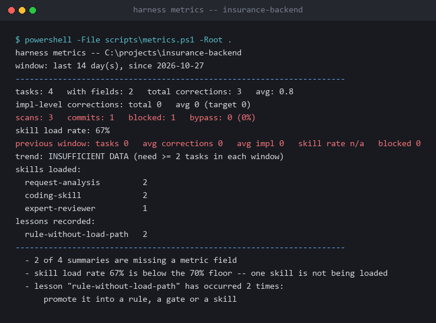
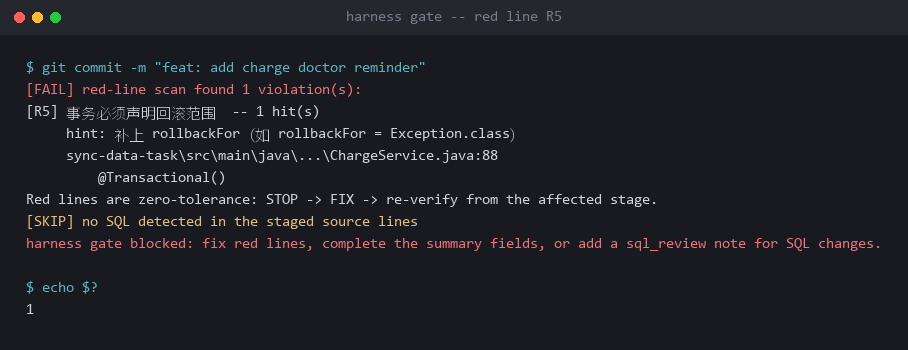

# 案例:在一个 12 模块的 Java 医疗合规系统上落地 Harness

> 一个真实存量项目的落地记录。项目名称、数据源地址、凭据位置与厂商名称均已脱敏;
> 技术栈、结构、规则与决策过程保持原样。
>
> **记录时间 2026-10-29（v1.18.0）**。下文所有状态——尤其第六节「还没做到的」——都是**当时**的状态,
> 不回填后续进展;包本身已迭代到 v1.27.0,机制变化见 [VERSION](../VERSION)。
>
> [English version](README.en.md)

---

## 一、起点

| | |
|---|---|
| 系统 | 医疗合规审核后端(与上游临床系统对接做医嘱/费用实时合规校验) |
| 技术栈 | Java 8 · Spring Boot 2.0.6 · **JFinal ORM**(不是 MyBatis/JPA)· Oracle + MSSQL + Redis · Maven 12 module |
| 测试 | **全仓库 2 个 `*Test.java`** |
| 存量红线违规 | **182 处** |
| 现成规则文件 | 无 |

这不是一个"新项目",也不是一个"整洁的存量项目"。它有三个会让大部分方案当场退场的特征:

1. **ORM 是 JFinal**,模板里的 `@Mapper` / XML 映射规则一条都用不上;
2. **182 处历史违规**——第一次扫描就报 182 条,任何"全量拦截"的门禁都会立刻被人关掉;
3. **几乎没有测试**——所以"跑测试"这类判据在头几个月里根本无法作为自动门禁。

---

## 二、冷启动:只装 9 个技能,不是 25 个

落地后的技能清单:

```
main-dev/       request-analysis · coding-skill · expert-reviewer · soap-endpoint-verify
biz-dev/        03-redis-cache · 04-sql-review · 05-transaction-consistency · rule-engine
trouble-shooting/ 01-slow-sql
```

**9 个,不是 25 个。** 冷启动上限是 8(硬上限),这 9 个里有几个是运行期按需加的。

更重要的是**每个技能都带证据锚点**。这是接地协议的要求:

```markdown
## 证据锚点

- [E2] cost-control-chronic/src/main/java/.../<慢病服务>.java :: 唯一 @Transactional 与慢病实现
- [E2] .trae/rules/project_rules.md :: 费用占比与离院方式剔除约束
```

规则:**没有 E1(可跑命令)或 E2(真实文件+行号)支撑的项目结论,不许进技能正文**,只能写 `TODO(待确认)`。

这条约束的价值在 `excerpt/.harness/modules/cost-control-chronic.md` 里体现得最清楚——

> 也是**全仓库唯一使用 `@Transactional` 的模块**,事务写法以它为准
>
> 费用占比计算需剔除诊断为 **某类诊断编码** 开头的病例
>
> 认为剔除逻辑一定生效 → 实际字典开关默认 '0'(关闭)

这类知识**只有真的读过这个项目才写得出来**。而一个通用模板包给不了。

---

## 三、红线裁剪:主动关掉三条

模板里有 8 条红线候选。这个项目**只启用了 4 条**,而且在 `AGENTS.md` 里写明了为什么:

| # | 红线 | 状态 |
|---|---|---|
| R1 | 金额用整数最小单位 | ❌ **不启用** |
| R2 | 缓存 Key 必须有统一前缀 | ❌ **不启用** |
| R3 | 异常必须走统一异常体系 | ✅ 启用 |
| R4 | 禁止字段注入 | ✅ 启用 |
| R5 | 事务必须声明回滚范围 | ✅ 启用 |
| R6 | 禁止敏感信息入日志 | ✅ 启用 |
| R7 | Mapper XML 禁止 `${}` | ❌ **不启用** |

> **R1 / R2 / R7 不启用**:本项目 0 个 XML 映射文件(JFinal),缓存 Key 统一封装在 `RedisUtils`,**启用只会误报**。

这是整个案例里最重要的一条经验:

> **一条不能被机器准确判定的红线,不是约束,是噪音。**
> 误报率高的规则会让人养成 `--no-verify` 的习惯,而 `--no-verify` 一旦成为默认,
> 你装的所有门禁都归零。

所以裁剪红线**不是妥协,是必要的设计工作**。改完之后 `red-line-rules.json` 里只剩 4 条:

```json
{
  "id": "R3",
  "name": "异常必须走统一异常体系",
  "pattern": "throw\\s+new\\s+(RuntimeException|IllegalStateException|IllegalArgumentException|Exception)\\b",
  "include": ["*.java"],
  "hint": "改用项目统一异常处理(见 aspect 模块的全局异常处理器)"
}
```

---

## 四、门禁第一次真跑起来时发生了什么

`excerpt/.harness/metrics/gate.jsonl` 是真实的门禁事件,一共 4 条:

```json
{"event":"scan","ts":"2026-10-27T14:18:34Z","blocked":0,"files":0,"hunks":0}
{"event":"scan","ts":"2026-10-29T13:54:34Z","blocked":1,"files":4,"hunks":7}
{"event":"scan","ts":"2026-10-29T15:36:59Z","blocked":0,"files":4,"hunks":7}
{"event":"commit","ts":"2026-10-29T15:37:00Z","hash":"7875cd51","scanned":1}
```

读法:

- **10-27** 第一次扫描,0 违规 —— 这是"只拦新增"生效后的结果
- **10-29** 扫到 **1 处违规被拦下**(4 个文件,7 个 hunk)
- **同一批文件**再扫一次,0 违规 —— 说明违规被改掉了
- **然后 commit,`scanned: 1`** —— 这次提交确实被门禁覆盖过

最后那条 `scanned` 字段是 `post-commit` 写的。它的用途是**算绕过率**:如果团队开始用 `--no-verify`,`scanned` 会变成 0,而 `metrics.ps1` 会把绕过率报出来。



> **没有 post-commit 计数,你就不知道门禁是不是已经名存实亡。**

同一份输出里还有几处**它没有粉饰的地方**:
- `2 of 4 summaries are missing a metric field` —— 有两个任务的摘要字段没填全
- `skill load rate 67% is below the 70% floor` —— 有个技能一直没被加载
- `trend: INSUFFICIENT DATA` —— 样本不够,不下结论

**度量脚本的作用不是让你好看,是让你看到没做好的地方。**

---

## 五、阶段门的第一版是"坏的"

这一段是案例里最有价值的部分,完整记录在
`excerpt/.harness/changes/load-coverage-and-gate/summary.md`。

### 5.1 阶段门读全量扫描 → 永远 BLOCKED

第一版阶段门的 `red-lines` 判据是"跑一次全量扫描"。在这个项目里:

> 存量 **182** 条违规会让门**永远 BLOCKED**

也就是说装上阶段门之后,任何阶段都过不去。**一个永远失败的门禁比没有门禁更糟**,因为人会开始找绕过的办法。

改法:`red-lines` 判据改读 `gate.jsonl` 的**最近一次 scan**,不再全量扫描。

真实的拦截输出长这样(R5 事务未声明回滚范围):



### 5.2 AGENTS.md 里的命令带占位符 → 自动执行会误报

阶段 3 的 `compiles` 判据是"真跑 AGENTS.md 里的必跑命令"。但这个项目的命令是:

```
mvn -q -pl <module> -am -DskipTests compile
```

`<module>` 是占位符。自动执行它会失败,然后阶段门报 BLOCKED —— **但实际上代码是好的**。

改法:`compiles` / `tests-green` 降级为 **HUMAN 判据**,由人确认。

> 说明:这是当时的项目改法。1.22.0 起包内默认用 AUTO + 三态判据:占位行 SKIP、
> 整行缺失 BLOCKED、真跑看退出码;不再因为一个 `<module>` 占位就整体降级为 HUMAN。

### 5.3 规则写在索引里,但没人读

这次任务的 `lesson_id` 是:

```
rule-without-load-path
```

原文:

> **规则只在索引里挂名、没有技能引用等于不存在。**

发现过程很具体:`编码规范.md`(红线依据)、`业务模型.md` / `数据模型.md` / `接口协议.md`(影响面判断依据)
—— **5 份文件实测 0 处引用**。

不读它们,红线就只是口号;不读三份 wiki,就判断不出影响面。

改法:把这 5 份文件接进具体技能:

| 文件 | 接进 |
|---|---|
| `编码规范.md` | `coding-skill`(红线依据)、`expert-reviewer`(评审依据) |
| `业务模型.md` | `request-analysis` |
| `数据模型.md` | `request-analysis`、`04-sql-review` |
| `接口协议.md` | `request-analysis` |
| `环境与工具.md` | `01-slow-sql` |

### 5.4 闭环的第一次闭环

这条教训**第 2 次出现时**,被晋升成了常驻纪律:

```
excerpt/.harness/metrics/promoted.txt
```

```
rule-without-load-path
```

机制是这样运作的:

```
任务里出现一条纠正
   ↓  给它一个固定的 lesson_id
写进 summary.md
   ↓  metrics.ps1 统计同一 lesson_id 的出现次数
第 2 次出现
   ↓  脚本直接给出结论:"promote it into a rule, a gate or a skill"
你把它写成规则 / 门禁 / 技能
   ↓  把 id 追加进 promoted.txt
verify-harness 不再提示(但仍统计次数)
```

**"第 2 次才晋升"从一句判断,变成了脚本数得出来的事实。**

---

## 六、还没做到的（截至 2026-10-29）

诚实地列出来。每一行都能在 `excerpt/` 里找到原始证据,不随包升级回填:

| 项 | 状态 |
|---|---|
| A1–A4 / A6 | 机制已建,但当时只在 harness 自维护任务上跑过,还没在真实业务需求上完整验过（`excerpt/.harness/changes/load-coverage-and-gate/summary.md` 的 `loaded_skills: none`、`touched_modules: none`） |
| A7(闭环) | 需要两个 14 天窗口。`promoted.txt` 里有一条记录,但趋势指标还不够样本 |
| 测试覆盖 | 项目原本只有 2 个测试文件,`tests-green` 判据因此长期是 HUMAN |
| 存量违规 | 182 条里只清了"新增不再引入",存量还债未开始 |
| 跨平台 | 门禁层跨 OS,体检层只在 Windows + PS 5.1 验证过 |

---

## 七、从这个案例能带走的

1. **红线要裁剪,不是照抄。** 不能机器准确判定的规则,启用只会制造噪音,而噪音会让人养成绕过的习惯。
2. **门禁必须"只拦新增"。** 存量项目第一次扫描报 182 条,全量拦截的门禁会立刻被关掉。
3. **判据要三态。** 整行缺失 → BLOCKED;占位符 → SKIP(明确标出来让人知道这条没验);真跑 → 看退出码。
4. **规则必须有人读。** 写进索引但没有任何技能引用它,等于没写。
5. **闭环要靠计数触发。** `lesson_id` 第 2 次出现 → 脚本提示晋升 → 写进 `promoted.txt`。
6. **文档要有权威声明。** 每份 wiki 开头写明"谁是权威、冲突以谁为准"。

---

## 八、附件

`excerpt/` 是这个项目的脱敏切片,原样保留:

| 文件 | 看什么 |
|---|---|
| `AGENTS.md` | 常驻文件长什么样:81 行,五块结构,红线表带"为什么不启用" |
| `.harness/stack.json` | 能力栈探测结果:自动识别出 JFinal 而非 MyBatis、Redis 走 `RedisUtils` |
| `.harness/rules/red-line-rules.json` | 裁剪后的 4 条红线,每条带可执行 pattern 与修复提示 |
| `.harness/modules/cost-control-chronic.md` | 模块卡:重点 / 难点 / 坑点 / 验证方式,每条带 E2 锚点 |
| `.harness/modules/datasource.md` | 数据源模块卡 |
| `.harness/changes/load-coverage-and-gate/summary.md` | **完整决策记录**:改了什么、为什么、影响面、怎么验的、还没做什么 |
| `.harness/metrics/gate.jsonl` | 4 条真实门禁事件 |
| `.harness/metrics/promoted.txt` | 已晋升的教训 |

---

## 附:脱敏说明

原始记录来自公司内网环境。公开前做了:

- 私有 IP → `10.0.0.x`
- 密码、口令 → `<redacted>`
- 绝对路径 → `<path>/…`
- 内网 URL → `<internal-url>`
- 公司名、产品名、第三方上游系统厂商名 → 中性描述
- 表名、类名、业务指标名 → 中性占位(如 `<费用明细表>` / `<同步补偿服务>` / `费用占比`)
- 2 行含凭据位置说明的整行删除

**技术栈、结构、规则、决策过程、数字一律保留原样。**
